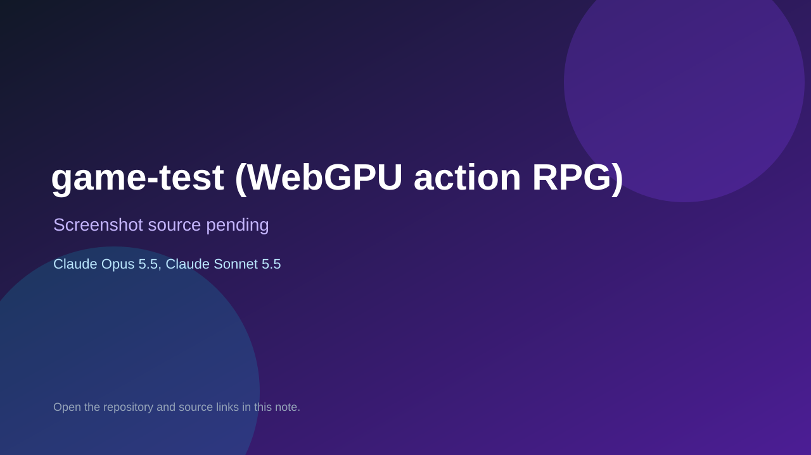

# game-test (WebGPU action RPG)

> Verified game note.

## At a glance

- **Score:** 7.6/10
- **Model:** Claude Opus 5.5, Claude Sonnet 5.5
- **Technology:** TypeScript, WebGPU, Browser
- **Estimated FP32 operations/s at 60 FPS:** 1,500,000,000 (low confidence; static estimate, not measured).
- **Rating basis:** Estimated from README, source tree and commit history; no runtime playtest.
- **Verified:** 2026-10-15
- **Repository:** [https://github.com/Kiikurage/game-test](https://github.com/Kiikurage/game-test)
- **Evidence:** [direct model evidence](https://github.com/Kiikurage/game-test/commit/52590e9ac68ab3c4504e73f5b12b0bf7c57a67db)
- **Live demo:** [open demo](https://kiikurage.github.io/game-test/)

## Screenshots

No screenshot source is recorded yet. Keep the placeholder until a repository, awesome list, or creator source provides an image.

## Model attribution

Open the evidence link above. Evidence grade: **direct model evidence**.

## Source description

WebGPU-only Elden Ring-like third-person action game for phones and desktop with a boss on a character state machine; commits co-author Claude Sonnet 5.5 and Claude Opus 5.5. Live demo returned HTTP 200 (availability only, not a playtest). Source inspected only; no playtest.

### Gameplay source

- [https://github.com/Kiikurage/game-test/blob/main/assets-src/blender/broken_column.py](https://github.com/Kiikurage/game-test/blob/main/assets-src/blender/broken_column.py)
- [https://github.com/Kiikurage/game-test/commit/52590e9ac68ab3c4504e73f5b12b0bf7c57a67db](https://github.com/Kiikurage/game-test/commit/52590e9ac68ab3c4504e73f5b12b0bf7c57a67db)

## Verification notes

- **Status:** verified_source_and_live_demo
- **Counted units in repository:** 1
- **Units covered by this note:** 1
- **Discovery:** GitHub commit pool: model+game commits 2026-10-08..2026-10-15 joined to repositories created after 2026-10-07T17:00Z; https://github.com/Kiikurage/game-test

[Back to the awesome list](../../README.md)
