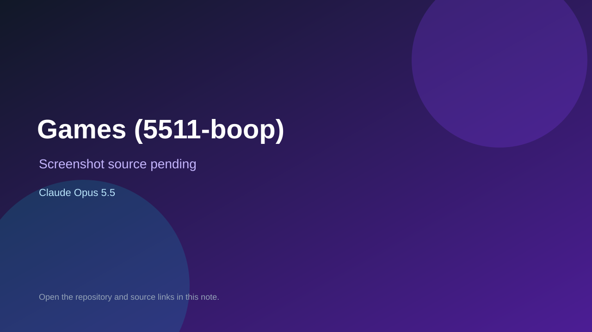

# Games (5511-boop)

> Verified game note.

## At a glance

- **Score:** 7.9/10
- **Model:** Claude Opus 5.5
- **Technology:** JavaScript, Browser
- **Estimated FP32 operations/s at 60 FPS:** 10,000,000 (low confidence; static estimate, not measured).
- **Rating basis:** Heuristic from source size, README and commit history (5.8 + 0.6*log10(code KB+1), +0.3 with a reachable demo); no runtime playtest.
- **Verified:** 2026-10-21
- **Repository:** [https://github.com/5511-boop/star-dash](https://github.com/5511-boop/star-dash)
- **Evidence:** [direct model evidence](https://github.com/5511-boop/star-dash/commit/5fe83d5610ab640206a1fa9a6b48d812d4f1ad7f)
- **Live demo:** [open demo](https://5511-boop.github.io/star-dash/haunted/)
- **Additional live link:** [open demo](https://5511-boop.github.io/star-dash/haunted/level2/)
- **Additional live link:** [open demo](https://5511-boop.github.io/star-dash/haunted/level3/)
- **Additional live link:** [open demo](https://5511-boop.github.io/star-dash/haunted/level4/)

## Screenshots

No screenshot source is recorded yet. Keep the placeholder until a repository, awesome list, or creator source provides an image.

## Model attribution

Open the evidence link above. Evidence grade: **direct model evidence**.

## Source description

Two-player browser games. One player creates a game and shares the 4-letter code; the other joins from any browser (works on iPhone). Commit carries an exact Claude Opus 5.5 co-author trailer. Live demo returned HTTP 200 (availability only, not a playtest). Source inspected from README, file tree and commit history only; no playtest.

### Gameplay source

- [https://github.com/5511-boop/star-dash/blob/main/haunted/index.html](https://github.com/5511-boop/star-dash/blob/main/haunted/index.html)
- [https://github.com/5511-boop/star-dash/commit/5fe83d5610ab640206a1fa9a6b48d812d4f1ad7f](https://github.com/5511-boop/star-dash/commit/5fe83d5610ab640206a1fa9a6b48d812d4f1ad7f)

## Verification notes

- **Status:** verified_source
- **Counted units in repository:** 1
- **Units covered by this note:** 1
- **Discovery:** GitHub commit pool: model+game commits 2026-10-17T01:00Z..2026-10-21T01:00Z (1-hour Opus, 3-hour Sonnet, 6-hour other UTC partitions) joined to repositories created after 2026-10-17T00:00Z; https://github.com/5511-boop/star-dash

[Back to the awesome list](../../README.md)
