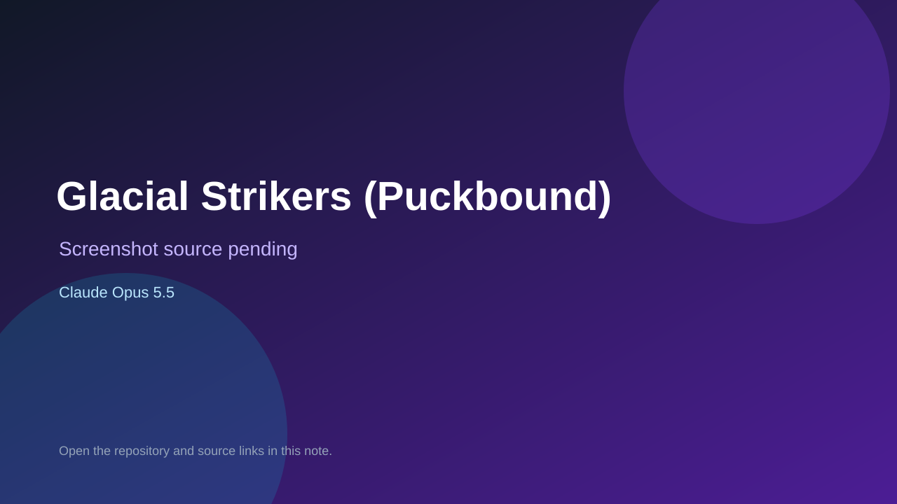

# Glacial Strikers (Puckbound)

> Top-list entry: **today** (#8), **this week** (#10).

## At a glance

- **Score:** 8.0/10
- **Model:** Claude Opus 5.5
- **Technology:** HTML, JavaScript, Canvas, Browser
- **Estimated FP32 operations/s at 60 FPS:** 200,000,000 (low confidence; static estimate, not measured).
- **Rating basis:** Estimated from README, source tree and commit history; no runtime playtest.
- **Verified:** 2026-10-15
- **Repository:** [https://github.com/sturlasnaer/glacial-strikers](https://github.com/sturlasnaer/glacial-strikers)
- **Evidence:** [direct model evidence](https://github.com/sturlasnaer/glacial-strikers/commit/8b764f331ea375af7881410e303e7f6134878691)

## Screenshots

No screenshot source is recorded yet. Keep the placeholder until a repository, awesome list, or creator source provides an image.

## Model attribution

Open the evidence link above. Evidence grade: **direct model evidence**.

## Source description

3-on-3 arcade hockey RPG for phones and browsers: run a club through a league and divisions, club editor, rivalry games; plain canvas ES modules; Claude Opus 5.5 trailers. Source inspected only; no playtest.

### Gameplay source

- [https://github.com/sturlasnaer/glacial-strikers/blob/main/assets/gfx/hud-kit/preview.html](https://github.com/sturlasnaer/glacial-strikers/blob/main/assets/gfx/hud-kit/preview.html)
- [https://github.com/sturlasnaer/glacial-strikers/commit/8b764f331ea375af7881410e303e7f6134878691](https://github.com/sturlasnaer/glacial-strikers/commit/8b764f331ea375af7881410e303e7f6134878691)

## Verification notes

- **Status:** verified_source
- **Counted units in repository:** 1
- **Units covered by this note:** 1
- **Discovery:** GitHub commit pool: model+game commits 2026-10-08..2026-10-15 joined to repositories created after 2026-10-07T17:00Z; https://github.com/sturlasnaer/glacial-strikers

[Back to the awesome list](../../README.md)
