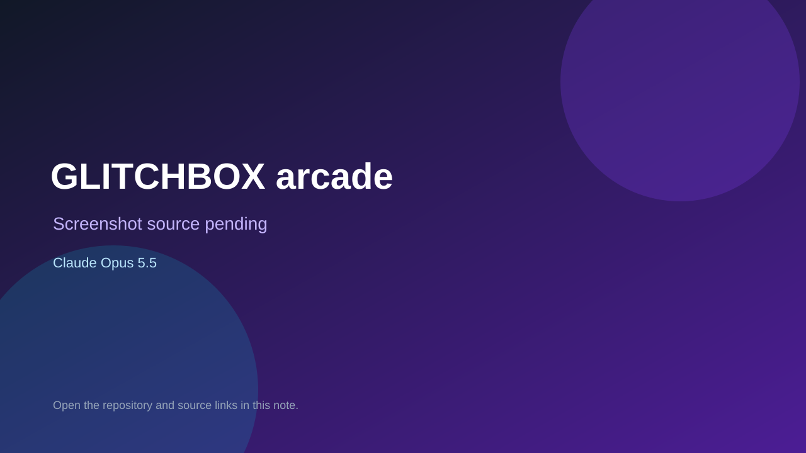

# GLITCHBOX arcade

> Verified game note.

## At a glance

- **Score:** 7.4/10
- **Model:** Claude Opus 5.5
- **Technology:** HTML, JavaScript, Canvas, Browser
- **Estimated FP32 operations/s at 60 FPS:** 100,000,000 (low confidence; static estimate, not measured).
- **Rating basis:** Estimated from README, source tree and commit history; no runtime playtest.
- **Verified:** 2026-10-15
- **Repository:** [https://github.com/glitchbox-games/glitchbox-games.github.io](https://github.com/glitchbox-games/glitchbox-games.github.io)
- **Evidence:** [direct model evidence](https://github.com/glitchbox-games/glitchbox-games.github.io/commit/fd0ca1e4f93938fe16749045f92b9d5876950fa0)

## Screenshots

No screenshot source is recorded yet. Keep the placeholder until a repository, awesome list, or creator source provides an image.

## Model attribution

Open the evidence link above. Evidence grade: **direct model evidence**.

## Source description

Browser arcade site with several small games (for example Midnight Post, a guard-the-gate night game); counted as one aggregate unit; commits co-author Claude Opus 5.5. Source inspected only; no playtest.

### Gameplay source

- [https://github.com/glitchbox-games/glitchbox-games.github.io/blob/main/_wp/00_head.html](https://github.com/glitchbox-games/glitchbox-games.github.io/blob/main/_wp/00_head.html)
- [https://github.com/glitchbox-games/glitchbox-games.github.io/commit/fd0ca1e4f93938fe16749045f92b9d5876950fa0](https://github.com/glitchbox-games/glitchbox-games.github.io/commit/fd0ca1e4f93938fe16749045f92b9d5876950fa0)

## Verification notes

- **Status:** verified_source
- **Counted units in repository:** 1
- **Units covered by this note:** 1
- **Discovery:** GitHub commit pool: model+game commits 2026-10-08..2026-10-15 joined to repositories created after 2026-10-07T17:00Z; https://github.com/glitchbox-games/glitchbox-games.github.io

[Back to the awesome list](../../README.md)
