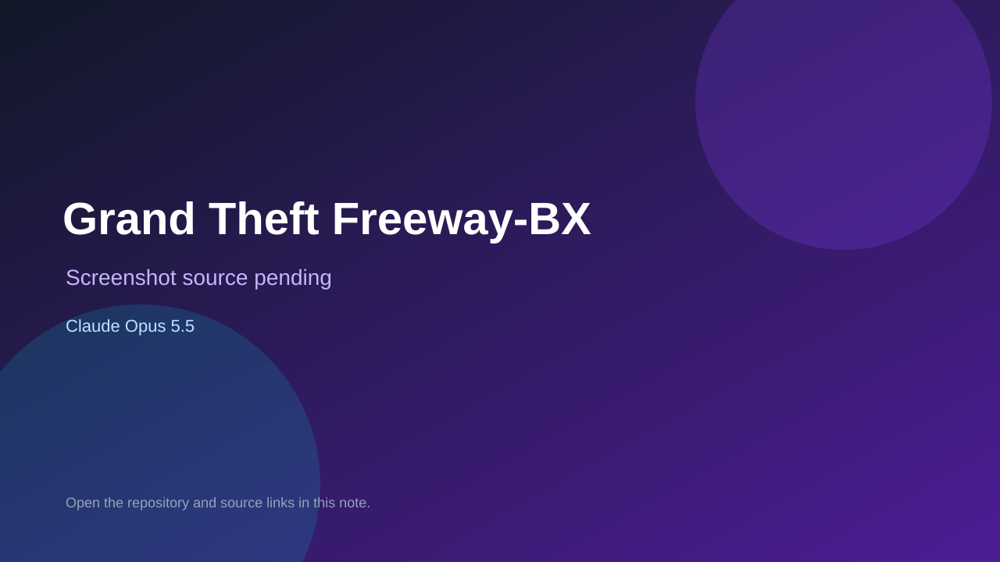

# Grand Theft Freeway-BX

> Verified game note.

## At a glance

- **Score:** 8.0/10
- **Model:** Claude Opus 5.5
- **Technology:** Rust, React
- **Estimated FP32 operations/s at 60 FPS:** 10,000,000 (low confidence; static estimate, not measured).
- **Rating basis:** Heuristic from source size, README and commit history (5.8 + 0.6*log10(code KB+1), +0.3 with a reachable demo); no runtime playtest.
- **Verified:** 2026-10-21
- **Repository:** [https://github.com/michaelcrosato/gtav-cco55-shardfall](https://github.com/michaelcrosato/gtav-cco55-shardfall)
- **Evidence:** [direct model evidence](https://github.com/michaelcrosato/gtav-cco55-shardfall/commit/44c017f5b160d2e0765c39c7447f5b93989a933f)

## Screenshots

No screenshot source is recorded yet. Keep the placeholder until a repository, awesome list, or creator source provides an image.

## Model attribution

Open the evidence link above. Evidence grade: **direct model evidence**.

## Source description

Auto V: a third-person open-world crime caper in Paloma Bay, a sun-bleached coastal district of. Commit carries an exact Claude Opus 5.5 co-author trailer. Source inspected from README, file tree and commit history only; no playtest.

### Gameplay source

- [https://github.com/michaelcrosato/gtav-cco55-shardfall/blob/main/crates/pav_core/src/props/read/v2.rs](https://github.com/michaelcrosato/gtav-cco55-shardfall/blob/main/crates/pav_core/src/props/read/v2.rs)
- [https://github.com/michaelcrosato/gtav-cco55-shardfall/commit/44c017f5b160d2e0765c39c7447f5b93989a933f](https://github.com/michaelcrosato/gtav-cco55-shardfall/commit/44c017f5b160d2e0765c39c7447f5b93989a933f)

## Verification notes

- **Status:** verified_source
- **Counted units in repository:** 1
- **Units covered by this note:** 1
- **Discovery:** GitHub commit pool: model+game commits 2026-10-17T01:00Z..2026-10-21T01:00Z (1-hour Opus, 3-hour Sonnet, 6-hour other UTC partitions) joined to repositories created after 2026-10-17T00:00Z; https://github.com/michaelcrosato/gtav-cco55-shardfall

[Back to the awesome list](../../README.md)
