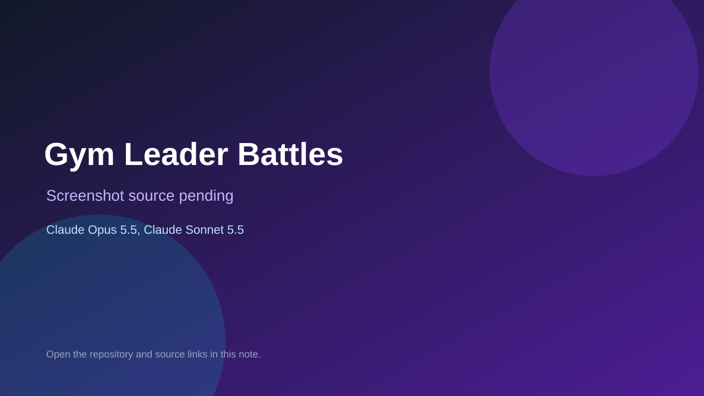

# Gym Leader Battles

> Verified game note.

## At a glance

- **Score:** 7.5/10
- **Model:** Claude Opus 5.5, Claude Sonnet 5.5
- **Technology:** JavaScript, Browser
- **Estimated FP32 operations/s at 60 FPS:** 10,000,000 (low confidence; static estimate, not measured).
- **Rating basis:** Heuristic from source size, README and commit history (5.8 + 0.6*log10(code KB+1), +0.3 with a reachable demo); no runtime playtest.
- **Verified:** 2026-10-23
- **Repository:** [https://github.com/trevermfield/Neofield](https://github.com/trevermfield/Neofield)
- **Evidence:** [direct model evidence](https://github.com/trevermfield/Neofield/commit/0781d54b35c56f567a7cbfa8aff09f7f7777b714)

## Screenshots

No screenshot source is recorded yet. Keep the placeholder until a repository, awesome list, or creator source provides an image.

## Model attribution

Open the evidence link above. Evidence grade: **direct model evidence**.

## Source description

Trever and Tyler's Neofield Region game. Adventure is the main game: Professor Okla, Tyler's Neofield Mons, routes, catching, 17 gyms and the Champion. The Battle Hall has single gym battles, Badge Rush (all 17 gyms back to back, then the Elite Four and… Commit carries an exact Claude Opus 5.5 / Claude Sonnet 5.5 co-author trailer. Source inspected from README, file tree and commit history only; no playtest.

### Gameplay source

- [https://github.com/trevermfield/Neofield/blob/main/game/app_script.html](https://github.com/trevermfield/Neofield/blob/main/game/app_script.html)
- [https://github.com/trevermfield/Neofield/commit/0781d54b35c56f567a7cbfa8aff09f7f7777b714](https://github.com/trevermfield/Neofield/commit/0781d54b35c56f567a7cbfa8aff09f7f7777b714)

## Verification notes

- **Status:** verified_source
- **Counted units in repository:** 1
- **Units covered by this note:** 1
- **Discovery:** GitHub commit pool: model+game commits 2026-10-21T01:00Z..2026-10-23T01:00Z (20-minute Opus 5.5 and wider other-model UTC partitions) joined to repositories created after 2026-10-20T01:00Z; https://github.com/trevermfield/Neofield

[Back to the awesome list](../../README.md)
