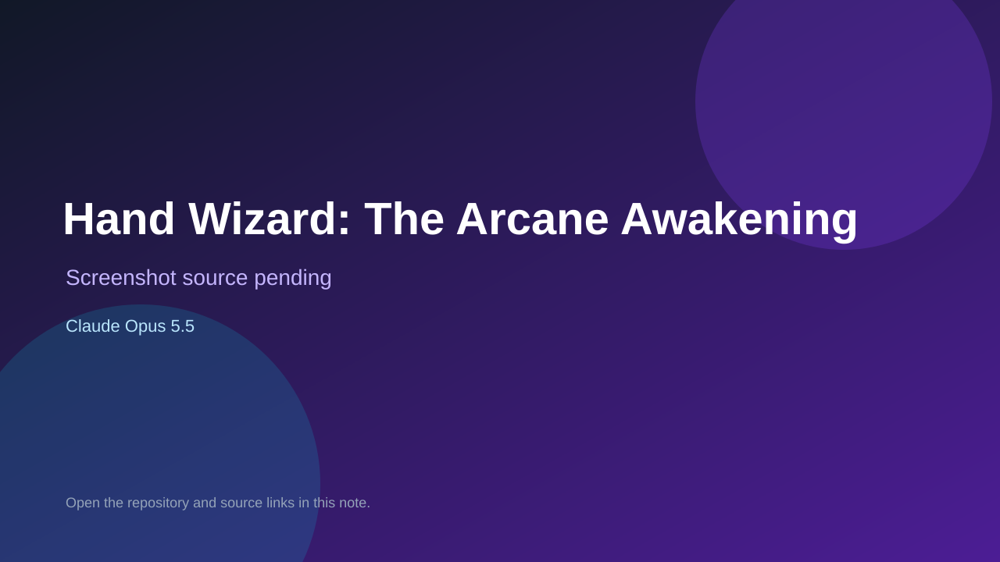

# Hand Wizard: The Arcane Awakening

> Verified game note.

## At a glance

- **Score:** 7.2/10
- **Model:** Claude Opus 5.5
- **Technology:** JavaScript, Three.js, Browser
- **Estimated FP32 operations/s at 60 FPS:** 1,000,000,000 (low confidence; static estimate, not measured).
- **Rating basis:** Heuristic from source size, README and commit history (5.8 + 0.6*log10(code KB+1), +0.3 with a reachable demo); no runtime playtest.
- **Verified:** 2026-10-23
- **Repository:** [https://github.com/Tanisha-dey18/hand-wizard](https://github.com/Tanisha-dey18/hand-wizard)
- **Evidence:** [direct model evidence](https://github.com/Tanisha-dey18/hand-wizard/commit/0666dde9f8584804d8541d58af2e6d982995d4f7)

## Screenshots

No screenshot source is recorded yet. Keep the placeholder until a repository, awesome list, or creator source provides an image.

## Model attribution

Open the evidence link above. Evidence grade: **direct model evidence**.

## Source description

A browser game where you cast spells with your real hand. Your webcam is tracked with MediaPipe Hand Landmarker, the world is rendered with Three.js, and every sound is generated live with the Web Audio API. There's no backend, no API key and no build step. Commit carries an exact Claude Opus 5.5 co-author trailer. Source inspected from README, file tree and commit history only; no playtest.

### Gameplay source

- [https://github.com/Tanisha-dey18/hand-wizard/blob/main/game.js](https://github.com/Tanisha-dey18/hand-wizard/blob/main/game.js)
- [https://github.com/Tanisha-dey18/hand-wizard/commit/0666dde9f8584804d8541d58af2e6d982995d4f7](https://github.com/Tanisha-dey18/hand-wizard/commit/0666dde9f8584804d8541d58af2e6d982995d4f7)

## Verification notes

- **Status:** verified_source
- **Counted units in repository:** 1
- **Units covered by this note:** 1
- **Discovery:** GitHub commit pool: model+game commits 2026-10-21T01:00Z..2026-10-23T01:00Z (20-minute Opus 5.5 and wider other-model UTC partitions) joined to repositories created after 2026-10-20T01:00Z; https://github.com/Tanisha-dey18/hand-wizard

[Back to the awesome list](../../README.md)
