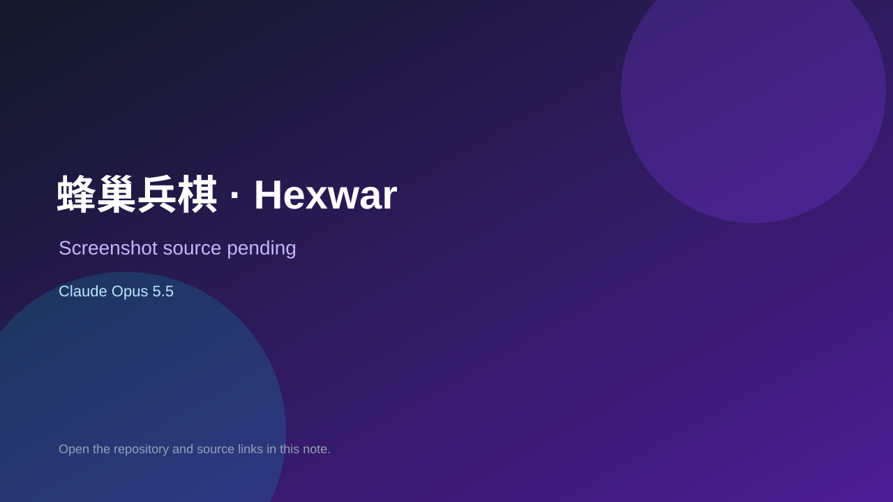

# 蜂巢兵棋 · Hexwar

> Top-list entry: **today** (#7), **this week** (#10), **this month** (#14).

## At a glance

- **Score:** 8.4/10
- **Model:** Claude Opus 5.5
- **Technology:** JavaScript, Browser
- **Estimated FP32 operations/s at 60 FPS:** 10,000,000 (low confidence; static estimate, not measured).
- **Rating basis:** Heuristic from source size, README and commit history (5.8 + 0.6*log10(code KB+1), +0.3 with a reachable demo); no runtime playtest.
- **Verified:** 2026-10-17
- **Repository:** [https://github.com/pphy96826-coder/hexwar](https://github.com/pphy96826-coder/hexwar)
- **Evidence:** [direct model evidence](https://github.com/pphy96826-coder/hexwar/commit/2b26d07d6d5f65a6bd7f1ed3492aebea84c3afa1)
- **Live demo:** [open demo](https://pphy96826-coder.github.io/hexwar/)

## Screenshots

No screenshot source is recorded yet. Keep the placeholder until a repository, awesome list, or creator source provides an image.

## Model attribution

Open the evidence link above. Evidence grade: **direct model evidence**.

## Source description

一个两人对战的六边形格子策略游戏，以及一个从零开始、靠自我对弈训练出来的 AI「宗师」。. Commit carries an exact Claude Opus 5.5 co-author trailer. Live demo returned HTTP 200 (availability only, not a playtest). Source inspected from README, file tree and commit history only; no playtest.

### Gameplay source

- [https://github.com/pphy96826-coder/hexwar/blob/main/hexwar.html](https://github.com/pphy96826-coder/hexwar/blob/main/hexwar.html)
- [https://github.com/pphy96826-coder/hexwar/commit/2b26d07d6d5f65a6bd7f1ed3492aebea84c3afa1](https://github.com/pphy96826-coder/hexwar/commit/2b26d07d6d5f65a6bd7f1ed3492aebea84c3afa1)

## Verification notes

- **Status:** verified_source
- **Counted units in repository:** 1
- **Units covered by this note:** 1
- **Discovery:** GitHub commit pool: model+game commits 2026-10-16..2026-10-17 (1-hour Opus, 3-hour Sonnet, 6-hour other UTC partitions) joined to repositories created after 2026-10-16T00:00Z; https://github.com/pphy96826-coder/hexwar

[Back to the awesome list](../../README.md)
