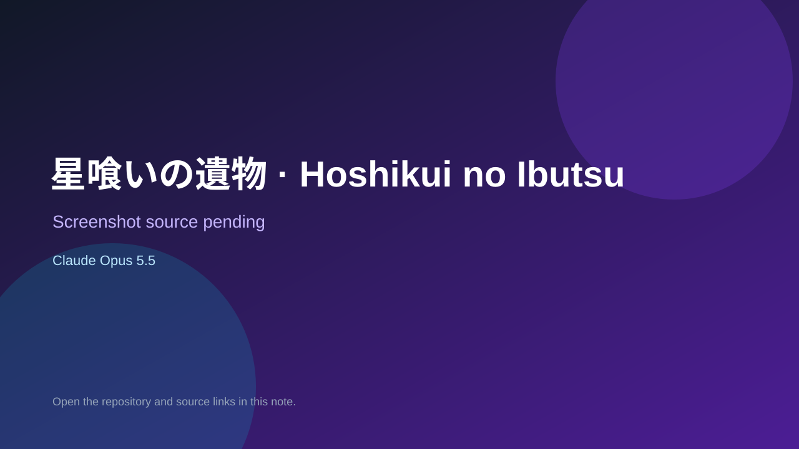

# 星喰いの遺物 · Hoshikui no Ibutsu

> Verified game note.

## At a glance

- **Score:** 7.1/10
- **Model:** Claude Opus 5.5
- **Technology:** TypeScript, Three.js, Browser
- **Estimated FP32 operations/s at 60 FPS:** 1,000,000,000 (low confidence; static estimate, not measured).
- **Rating basis:** Heuristic from source size, README and commit history (5.8 + 0.6*log10(code KB+1), +0.3 with a reachable demo); no runtime playtest.
- **Verified:** 2026-10-23
- **Repository:** [https://github.com/inoxixi7/hoshikui](https://github.com/inoxixi7/hoshikui)
- **Evidence:** [direct model evidence](https://github.com/inoxixi7/hoshikui/commit/1d56f5eeadcc612866b92bffd8e9f013274be970)

## Screenshots

No screenshot source is recorded yet. Keep the placeholder until a repository, awesome list, or creator source provides an image.

## Model attribution

Open the evidence link above. Evidence grade: **direct model evidence**.

## Source description

一件星之遗物悬浮在石台上，远处一颗星星是世界里唯一的光源。玩家推倒遗物、让星光照进裂缝，借助外壳上亮起的星脉制造视觉错位，让体内的一滴星光液滴一路滚进核心。最后一关里，遗物会把那颗星吞下去。. Commit carries an exact Claude Opus 5.5 co-author trailer. Source inspected from README, file tree and commit history only; no playtest.

### Gameplay source

- [https://github.com/inoxixi7/hoshikui/blob/main/src/relic/relicView.ts](https://github.com/inoxixi7/hoshikui/blob/main/src/relic/relicView.ts)
- [https://github.com/inoxixi7/hoshikui/commit/1d56f5eeadcc612866b92bffd8e9f013274be970](https://github.com/inoxixi7/hoshikui/commit/1d56f5eeadcc612866b92bffd8e9f013274be970)

## Verification notes

- **Status:** verified_source
- **Counted units in repository:** 1
- **Units covered by this note:** 1
- **Discovery:** GitHub commit pool: model+game commits 2026-10-21T01:00Z..2026-10-23T01:00Z (20-minute Opus 5.5 and wider other-model UTC partitions) joined to repositories created after 2026-10-20T01:00Z; https://github.com/inoxixi7/hoshikui

[Back to the awesome list](../../README.md)
