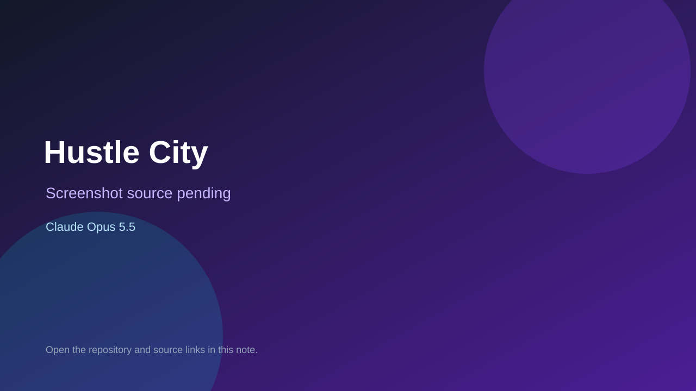

# Hustle City

> Verified game note.

## At a glance

- **Score:** 7.8/10
- **Model:** Claude Opus 5.5
- **Technology:** Kotlin
- **Estimated FP32 operations/s at 60 FPS:** 1,000,000,000 (low confidence; static estimate, not measured).
- **Rating basis:** Heuristic from source size, README and commit history (5.8 + 0.6*log10(code KB+1), +0.3 with a reachable demo); no runtime playtest.
- **Verified:** 2026-10-21
- **Repository:** [https://github.com/zaizkuu/Hustle-City](https://github.com/zaizkuu/Hustle-City)
- **Evidence:** [direct model evidence](https://github.com/zaizkuu/Hustle-City/commit/1f081332bb0989f829d37f9f9b3576953bf5febb)

## Screenshots

No screenshot source is recorded yet. Keep the placeholder until a repository, awesome list, or creator source provides an image.

## Model attribution

Open the evidence link above. Evidence grade: **direct model evidence**.

## Source description

A business life-simulation game for Android, inspired by Big Ambitions. Start with a small apartment, a beat-up car and $5,000. Rent a storefront, furnish it, stock it, hire staff, and grow a business empire in a living 3D city. Commit carries an exact Claude Opus 5.5 co-author trailer. Source inspected from README, file tree and commit history only; no playtest.

### Gameplay source

- [https://github.com/zaizkuu/Hustle-City/blob/claude/big-ambitions-android-06tacm/app/src/main/java/com/hustlecity/game/render/Landmarks.kt](https://github.com/zaizkuu/Hustle-City/blob/claude/big-ambitions-android-06tacm/app/src/main/java/com/hustlecity/game/render/Landmarks.kt)
- [https://github.com/zaizkuu/Hustle-City/commit/1f081332bb0989f829d37f9f9b3576953bf5febb](https://github.com/zaizkuu/Hustle-City/commit/1f081332bb0989f829d37f9f9b3576953bf5febb)

## Verification notes

- **Status:** verified_source
- **Counted units in repository:** 1
- **Units covered by this note:** 1
- **Discovery:** GitHub commit pool: model+game commits 2026-10-17T01:00Z..2026-10-21T01:00Z (1-hour Opus, 3-hour Sonnet, 6-hour other UTC partitions) joined to repositories created after 2026-10-17T00:00Z; https://github.com/zaizkuu/Hustle-City

[Back to the awesome list](../../README.md)
