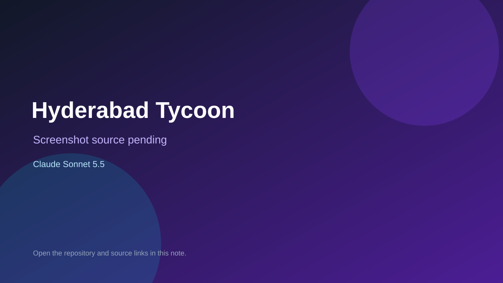

# Hyderabad Tycoon

> Verified game note.

## At a glance

- **Score:** 7.9/10
- **Model:** Claude Sonnet 5.5
- **Technology:** JavaScript, React, Browser
- **Estimated FP32 operations/s at 60 FPS:** 10,000,000 (low confidence; static estimate, not measured).
- **Rating basis:** Heuristic from source size, README and commit history (5.8 + 0.6*log10(code KB+1), +0.3 with a reachable demo); no runtime playtest.
- **Verified:** 2026-10-17
- **Repository:** [https://github.com/somapujith/GameHub](https://github.com/somapujith/GameHub)
- **Evidence:** [direct model evidence](https://github.com/somapujith/GameHub/commit/3b43d2df78de515d672c175bc30b135f5e6cb4fc)
- **Live demo:** [open demo](https://gamezone-sigma-blond.vercel.app)

## Screenshots

No screenshot source is recorded yet. Keep the placeholder until a repository, awesome list, or creator source provides an image.

## Model attribution

Open the evidence link above. Evidence grade: **direct model evidence**.

## Source description

A Hyderabad-themed Monopoly-style business game: React 19 + Vite on the front, one Cloudflare Worker (Hono) with Durable Objects for real-time rooms, Neon Postgres for accounts / friends / match history, Google Sign-In. Commit carries an exact Claude Sonnet 5.5 co-author trailer. Live demo returned HTTP 200 (availability only, not a playtest). Source inspected from README, file tree and commit history only; no playtest.

### Gameplay source

- [https://github.com/somapujith/GameHub/blob/main/src/data/voices.events.js](https://github.com/somapujith/GameHub/blob/main/src/data/voices.events.js)
- [https://github.com/somapujith/GameHub/commit/3b43d2df78de515d672c175bc30b135f5e6cb4fc](https://github.com/somapujith/GameHub/commit/3b43d2df78de515d672c175bc30b135f5e6cb4fc)

## Verification notes

- **Status:** verified_source
- **Counted units in repository:** 1
- **Units covered by this note:** 1
- **Discovery:** GitHub commit pool: model+game commits 2026-10-16..2026-10-17 (1-hour Opus, 3-hour Sonnet, 6-hour other UTC partitions) joined to repositories created after 2026-10-16T00:00Z; https://github.com/somapujith/GameHub

[Back to the awesome list](../../README.md)
