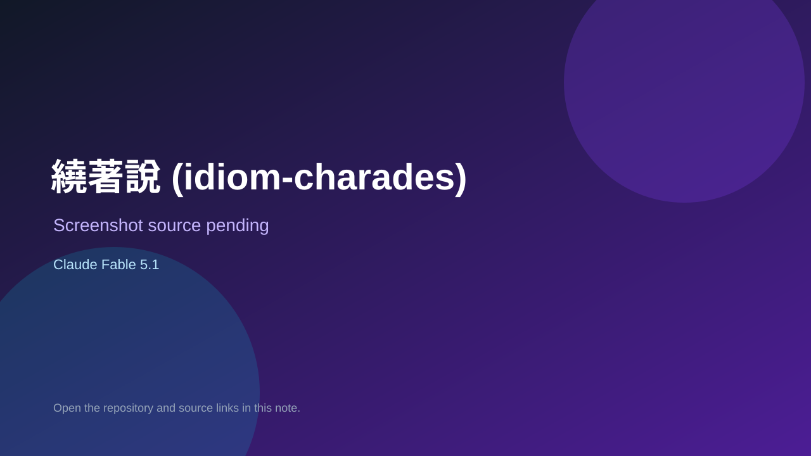

# 繞著說 (idiom-charades)

> Verified game note.

## At a glance

- **Score:** 7.0/10
- **Model:** Claude Fable 5.1
- **Technology:** TypeScript, Browser
- **Estimated FP32 operations/s at 60 FPS:** 10,000,000 (low confidence; static estimate, not measured).
- **Rating basis:** Heuristic from source size, README and commit history (5.8 + 0.6*log10(code KB+1), +0.3 with a reachable demo); no runtime playtest.
- **Verified:** 2026-10-17
- **Repository:** [https://github.com/JingJerYen/idiom-guess](https://github.com/JingJerYen/idiom-guess)
- **Evidence:** [direct model evidence](https://github.com/JingJerYen/idiom-guess/commit/dae1d5cabb17d1d8589dad9c2e8f54845f04d533)

## Screenshots

No screenshot source is recorded yet. Keep the placeholder until a repository, awesome list, or creator source provides an image.

## Model attribution

Open the evidence link above. Evidence grade: **direct model evidence**.

## Source description

練習英文「換句話說」(circumlocution) 的網頁小遊戲。. Commit carries an exact Claude Fable 5.1 co-author trailer. Source inspected from README, file tree and commit history only; no playtest.

### Gameplay source

- [https://github.com/JingJerYen/idiom-guess/blob/claude/funny-davinci-icllhk/web/src/app.ts](https://github.com/JingJerYen/idiom-guess/blob/claude/funny-davinci-icllhk/web/src/app.ts)
- [https://github.com/JingJerYen/idiom-guess/commit/dae1d5cabb17d1d8589dad9c2e8f54845f04d533](https://github.com/JingJerYen/idiom-guess/commit/dae1d5cabb17d1d8589dad9c2e8f54845f04d533)

## Verification notes

- **Status:** verified_source
- **Counted units in repository:** 1
- **Units covered by this note:** 1
- **Discovery:** GitHub commit pool: model+game commits 2026-10-16..2026-10-17 (1-hour Opus, 3-hour Sonnet, 6-hour other UTC partitions) joined to repositories created after 2026-10-16T00:00Z; https://github.com/JingJerYen/idiom-guess

[Back to the awesome list](../../README.md)
