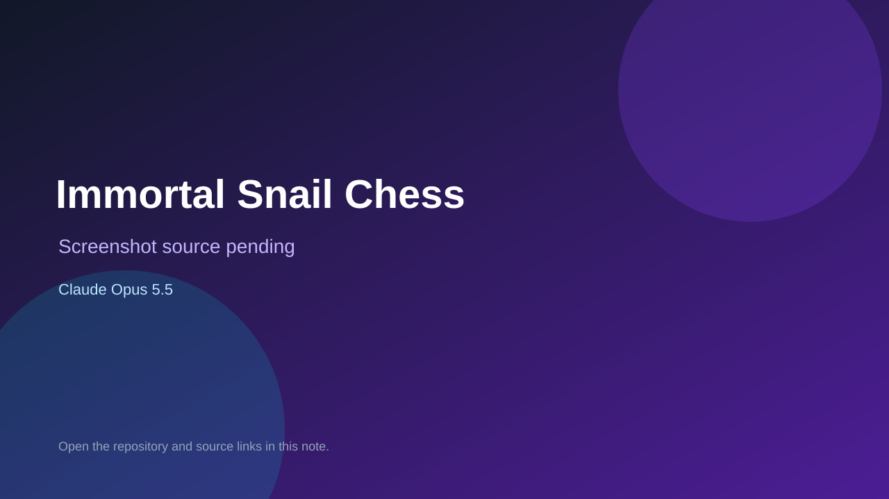

# Immortal Snail Chess

> Verified game note.

## At a glance

- **Score:** 7.3/10
- **Model:** Claude Opus 5.5
- **Technology:** JavaScript, Chess, Browser
- **Estimated FP32 operations/s at 60 FPS:** 50,000,000 (low confidence; static estimate, not measured).
- **Rating basis:** Estimated from README, source tree and commit history; no runtime playtest.
- **Verified:** 2026-10-15
- **Repository:** [https://github.com/sirsigmund79/snail-chess](https://github.com/sirsigmund79/snail-chess)
- **Evidence:** [direct model evidence](https://github.com/sirsigmund79/snail-chess/commit/768f3bed4d8703a149e684714f3314f966af86a7)

## Screenshots

No screenshot source is recorded yet. Keep the placeholder until a repository, awesome list, or creator source provides an image.

## Model attribution

Open the evidence link above. Evidence grade: **direct model evidence**.

## Source description

Chess variant with two immortal snails that advance every three moves and crush pieces; a snail reaching a king wins; browser-only; Claude Opus 5.5 trailers. Source inspected only; no playtest.

### Gameplay source

- [https://github.com/sirsigmund79/snail-chess/blob/feat/snail-chess-mvp/.claude/skills/oil-ui/assets/style-explorer.html](https://github.com/sirsigmund79/snail-chess/blob/feat/snail-chess-mvp/.claude/skills/oil-ui/assets/style-explorer.html)
- [https://github.com/sirsigmund79/snail-chess/commit/768f3bed4d8703a149e684714f3314f966af86a7](https://github.com/sirsigmund79/snail-chess/commit/768f3bed4d8703a149e684714f3314f966af86a7)

## Verification notes

- **Status:** verified_source
- **Counted units in repository:** 1
- **Units covered by this note:** 1
- **Discovery:** GitHub commit pool: model+game commits 2026-10-08..2026-10-15 joined to repositories created after 2026-10-07T17:00Z; https://github.com/sirsigmund79/snail-chess

[Back to the awesome list](../../README.md)
