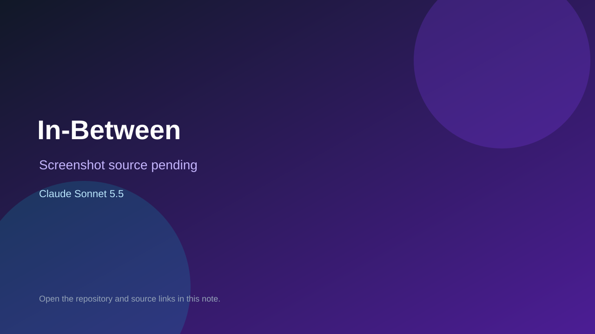

# In-Between

> Verified game note.

## At a glance

- **Score:** 7.2/10
- **Model:** Claude Sonnet 5.5
- **Technology:** JavaScript, Three.js, Browser
- **Estimated FP32 operations/s at 60 FPS:** 1,000,000,000 (low confidence; static estimate, not measured).
- **Rating basis:** Heuristic from source size, README and commit history (5.8 + 0.6*log10(code KB+1), +0.3 with a reachable demo); no runtime playtest.
- **Verified:** 2026-10-21
- **Repository:** [https://github.com/theArkein/in-between-online](https://github.com/theArkein/in-between-online)
- **Evidence:** [direct model evidence](https://github.com/theArkein/in-between-online/commit/b2d08d40a64294858d29ec92e371404915e3a0ba)

## Screenshots

No screenshot source is recorded yet. Keep the placeholder until a repository, awesome list, or creator source provides an image.

## Model attribution

Open the evidence link above. Evidence grade: **direct model evidence**.

## Source description

A card game for friends. Two cards are dealt to every player, then you bet on whether the next card lands strictly between them. 3D table, sound effects, works on phones and laptops. Play on one shared screen, or online with each friend on their own device. Commit carries an exact Claude Sonnet 5.5 co-author trailer. Source inspected from README, file tree and commit history only; no playtest.

### Gameplay source

- [https://github.com/theArkein/in-between-online/blob/main/index.html](https://github.com/theArkein/in-between-online/blob/main/index.html)
- [https://github.com/theArkein/in-between-online/commit/b2d08d40a64294858d29ec92e371404915e3a0ba](https://github.com/theArkein/in-between-online/commit/b2d08d40a64294858d29ec92e371404915e3a0ba)

## Verification notes

- **Status:** verified_source
- **Counted units in repository:** 1
- **Units covered by this note:** 1
- **Discovery:** GitHub commit pool: model+game commits 2026-10-17T01:00Z..2026-10-21T01:00Z (1-hour Opus, 3-hour Sonnet, 6-hour other UTC partitions) joined to repositories created after 2026-10-17T00:00Z; https://github.com/theArkein/in-between-online

[Back to the awesome list](../../README.md)
