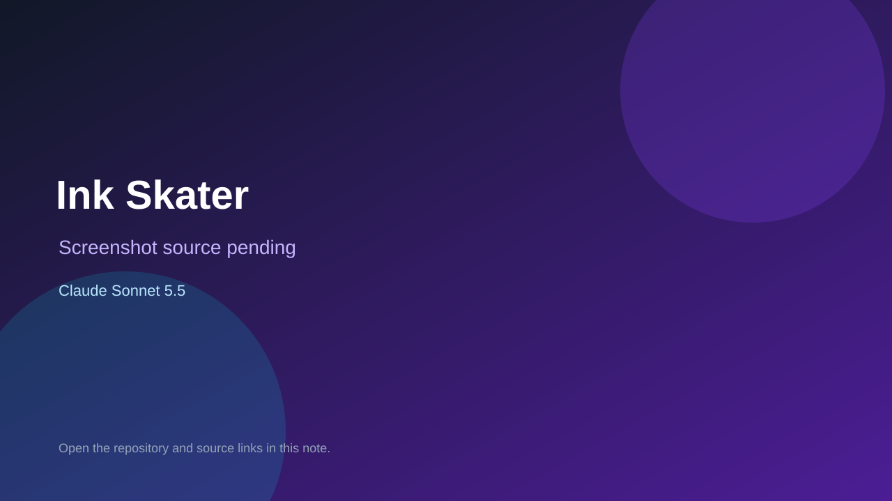

# Ink Skater

> Verified game note.

## At a glance

- **Score:** 7.1/10
- **Model:** Claude Sonnet 5.5
- **Technology:** TypeScript, React, Browser
- **Estimated FP32 operations/s at 60 FPS:** 100,000,000 (low confidence; static estimate, not measured).
- **Rating basis:** Heuristic from source size, README and commit history (5.8 + 0.6*log10(code KB+1), +0.3 with a reachable demo); no runtime playtest.
- **Verified:** 2026-10-23
- **Repository:** [https://github.com/alon-hoffman/ink-skater](https://github.com/alon-hoffman/ink-skater)
- **Evidence:** [direct model evidence](https://github.com/alon-hoffman/ink-skater/commit/bdcb27c02d0d224b4ac36bbac04507a5b5cccb98)

## Screenshots

No screenshot source is recorded yet. Keep the placeholder until a repository, awesome list, or creator source provides an image.

## Model attribution

Open the evidence link above. Evidence grade: **direct model evidence**.

## Source description

A 2D side-scrolling skateboard physics game drawn like a black-pen sketch on notebook paper, with five hand-built levels and a full level editor. React + TypeScript + Vite, Matter.js physics, Canvas 2D rendering, Web Audio sound, localStorage persistence. No… Commit carries an exact Claude Sonnet 5.5 co-author trailer. Source inspected from README, file tree and commit history only; no playtest.

### Gameplay source

- [https://github.com/alon-hoffman/ink-skater/blob/main/src/game/Simulation.ts](https://github.com/alon-hoffman/ink-skater/blob/main/src/game/Simulation.ts)
- [https://github.com/alon-hoffman/ink-skater/commit/bdcb27c02d0d224b4ac36bbac04507a5b5cccb98](https://github.com/alon-hoffman/ink-skater/commit/bdcb27c02d0d224b4ac36bbac04507a5b5cccb98)

## Verification notes

- **Status:** verified_source
- **Counted units in repository:** 1
- **Units covered by this note:** 1
- **Discovery:** GitHub commit pool: model+game commits 2026-10-21T01:00Z..2026-10-23T01:00Z (20-minute Opus 5.5 and wider other-model UTC partitions) joined to repositories created after 2026-10-20T01:00Z; https://github.com/alon-hoffman/ink-skater

[Back to the awesome list](../../README.md)
