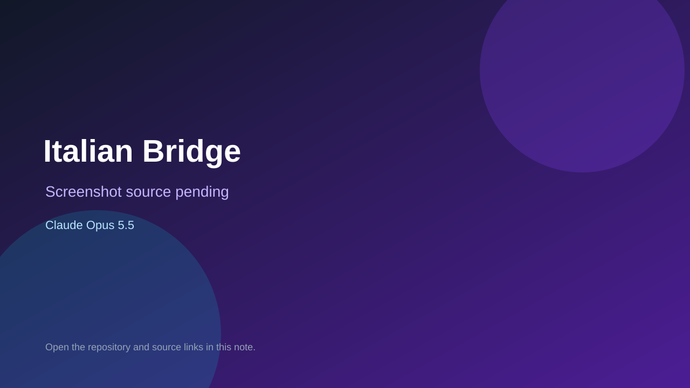

# Italian Bridge

> Verified game note.

## At a glance

- **Score:** 7.3/10
- **Model:** Claude Opus 5.5
- **Technology:** TypeScript, React, Browser
- **Estimated FP32 operations/s at 60 FPS:** 10,000,000 (low confidence; static estimate, not measured).
- **Rating basis:** Heuristic from source size, README and commit history (5.8 + 0.6*log10(code KB+1), +0.3 with a reachable demo); no runtime playtest.
- **Verified:** 2026-10-21
- **Repository:** [https://github.com/aashikelahe/italian-bridge](https://github.com/aashikelahe/italian-bridge)
- **Evidence:** [direct model evidence](https://github.com/aashikelahe/italian-bridge/commit/e4cc8cdd687a3e21af5b8e6fe42304058b58d138)

## Screenshots

No screenshot source is recorded yet. Keep the placeholder until a repository, awesome list, or creator source provides an image.

## Model attribution

Open the evidence link above. Evidence grade: **direct model evidence**.

## Source description

A desktop-first, browser-based version of Italian Bridge (Italian Call Bridge): four players, one 52-card deck, a 5 + 4 + 4 deal, one-turn bidding from 7 to 13, a reshuffle call, a hidden reserved trump card, and bid-based scoring. Play against three computer… Commit carries an exact Claude Opus 5.5 co-author trailer. Source inspected from README, file tree and commit history only; no playtest.

### Gameplay source

- [https://github.com/aashikelahe/italian-bridge/blob/main/src/ui/bn.ts](https://github.com/aashikelahe/italian-bridge/blob/main/src/ui/bn.ts)
- [https://github.com/aashikelahe/italian-bridge/commit/e4cc8cdd687a3e21af5b8e6fe42304058b58d138](https://github.com/aashikelahe/italian-bridge/commit/e4cc8cdd687a3e21af5b8e6fe42304058b58d138)

## Verification notes

- **Status:** verified_source
- **Counted units in repository:** 1
- **Units covered by this note:** 1
- **Discovery:** GitHub commit pool: model+game commits 2026-10-17T01:00Z..2026-10-21T01:00Z (1-hour Opus, 3-hour Sonnet, 6-hour other UTC partitions) joined to repositories created after 2026-10-17T00:00Z; https://github.com/aashikelahe/italian-bridge

[Back to the awesome list](../../README.md)
