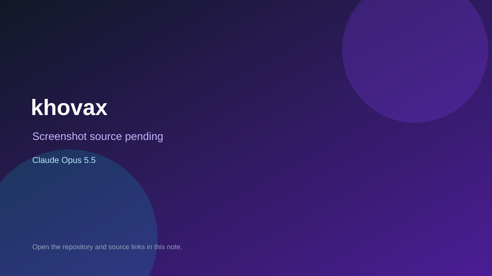

# khovax

> Verified game note.

## At a glance

- **Score:** 7.3/10
- **Model:** Claude Opus 5.5
- **Technology:** Godot, GDScript
- **Estimated FP32 operations/s at 60 FPS:** 300,000,000 (low confidence; static estimate, not measured).
- **Rating basis:** Estimated from README, source tree and commit history; no runtime playtest.
- **Verified:** 2026-10-15
- **Repository:** [https://github.com/Flixbox/khovax](https://github.com/Flixbox/khovax)
- **Evidence:** [direct model evidence](https://github.com/Flixbox/khovax/commit/f35f270b07d160a83718808c92396223f8ca307c)

## Screenshots

No screenshot source is recorded yet. Keep the placeholder until a repository, awesome list, or creator source provides an image.

## Model attribution

Open the evidence link above. Evidence grade: **direct model evidence**.

## Source description

Codename for a top-down real-time hex-grid ARPG where you catch monsters by walking rings around them; Godot 4; Claude Opus 5.5 trailers. Work in progress. Source inspected only; no playtest.

### Gameplay source

- [https://github.com/Flixbox/khovax/blob/main/docs/design.html](https://github.com/Flixbox/khovax/blob/main/docs/design.html)
- [https://github.com/Flixbox/khovax/commit/f35f270b07d160a83718808c92396223f8ca307c](https://github.com/Flixbox/khovax/commit/f35f270b07d160a83718808c92396223f8ca307c)

## Verification notes

- **Status:** verified_source
- **Counted units in repository:** 1
- **Units covered by this note:** 1
- **Discovery:** GitHub commit pool: model+game commits 2026-10-08..2026-10-15 joined to repositories created after 2026-10-07T17:00Z; https://github.com/Flixbox/khovax

[Back to the awesome list](../../README.md)
