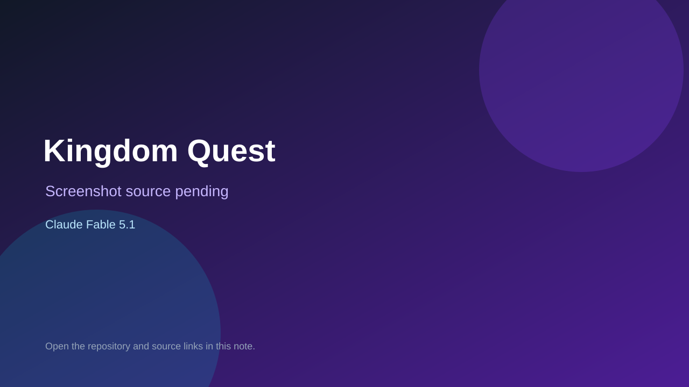

# Kingdom Quest

> Verified game note.

## At a glance

- **Score:** 8.1/10
- **Model:** Claude Fable 5.1
- **Technology:** JavaScript, Browser
- **Estimated FP32 operations/s at 60 FPS:** 10,000,000 (low confidence; static estimate, not measured).
- **Rating basis:** Heuristic from source size, README and commit history (5.8 + 0.6*log10(code KB+1), +0.3 with a reachable demo); no runtime playtest.
- **Verified:** 2026-10-17
- **Repository:** [https://github.com/M-turtle/kingdom-quest](https://github.com/M-turtle/kingdom-quest)
- **Evidence:** [direct model evidence](https://github.com/M-turtle/kingdom-quest/commit/a74389c7e7990dcdac27844980e791546b116fac)

## Screenshots

No screenshot source is recorded yet. Keep the placeholder until a repository, awesome list, or creator source provides an image.

## Model attribution

Open the evidence link above. Evidence grade: **direct model evidence**.

## Source description

Kingdom Quest: a kids' learning kingdom (math, reading, chess, music, art, nature, space). Commit carries an exact Claude Fable 5.1 co-author trailer. Source inspected from README, file tree and commit history only; no playtest.

### Gameplay source

- [https://github.com/M-turtle/kingdom-quest/blob/main/shared/games/pirate_models.js](https://github.com/M-turtle/kingdom-quest/blob/main/shared/games/pirate_models.js)
- [https://github.com/M-turtle/kingdom-quest/commit/a74389c7e7990dcdac27844980e791546b116fac](https://github.com/M-turtle/kingdom-quest/commit/a74389c7e7990dcdac27844980e791546b116fac)

## Verification notes

- **Status:** verified_source
- **Counted units in repository:** 1
- **Units covered by this note:** 1
- **Discovery:** GitHub commit pool: model+game commits 2026-10-16..2026-10-17 (1-hour Opus, 3-hour Sonnet, 6-hour other UTC partitions) joined to repositories created after 2026-10-16T00:00Z; https://github.com/M-turtle/kingdom-quest

[Back to the awesome list](../../README.md)
