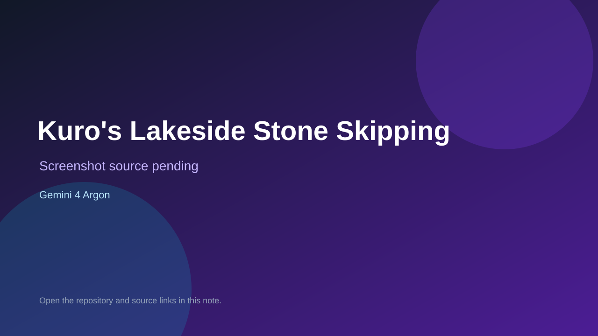

# Kuro's Lakeside Stone Skipping

> Verified game note.

## At a glance

- **Score:** 7.2/10
- **Model:** Gemini 4 Argon
- **Technology:** HTML, JavaScript, Canvas, Browser
- **Estimated FP32 operations/s at 60 FPS:** 200,000,000 (low confidence; static estimate, not measured).
- **Rating basis:** Estimated from README, source tree and commit history; no runtime playtest.
- **Verified:** 2026-10-15
- **Repository:** [https://github.com/ShreyashGawas777/kuros-lakeside-stone-skipping](https://github.com/ShreyashGawas777/kuros-lakeside-stone-skipping)
- **Evidence:** [creator-reported model evidence](https://github.com/ShreyashGawas777/kuros-lakeside-stone-skipping)
- **Live demo:** [open demo](https://shreyashgawas777.github.io/kuros-lakeside-stone-skipping/)

## Screenshots

No screenshot source is recorded yet. Keep the placeholder until a repository, awesome list, or creator source provides an image.

## Model attribution

Open the evidence link above. Evidence grade: **creator-reported model evidence**.

## Source description

Single-file (~610 KB) stone-skipping game starring a cat; the description says it was made by Gemini 4 Argon from the creator's game details. No trailer. Live demo returned HTTP 200 (availability only, not a playtest). Source inspected only; no playtest.

### Gameplay source

- [https://github.com/ShreyashGawas777/kuros-lakeside-stone-skipping/blob/main/index.html](https://github.com/ShreyashGawas777/kuros-lakeside-stone-skipping/blob/main/index.html)
- [https://github.com/ShreyashGawas777/kuros-lakeside-stone-skipping](https://github.com/ShreyashGawas777/kuros-lakeside-stone-skipping)

## Verification notes

- **Status:** verified_source_and_live_demo
- **Counted units in repository:** 1
- **Units covered by this note:** 1
- **Discovery:** GitHub repository search: exact model phrase, created 2026-10-08..2026-10-15 (UTC partitions); https://github.com/ShreyashGawas777/kuros-lakeside-stone-skipping

[Back to the awesome list](../../README.md)
