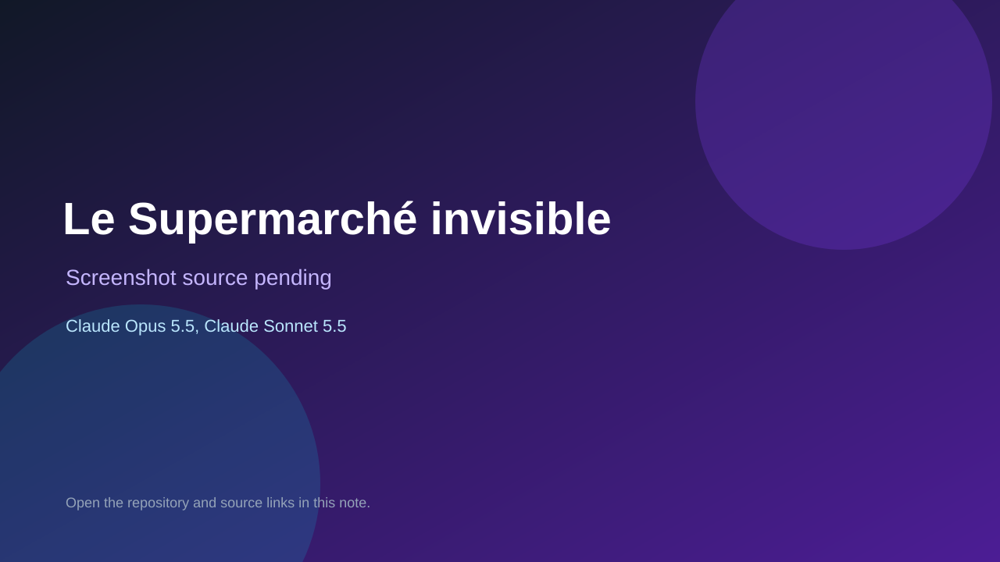

# Le Supermarché invisible

> Verified game note.

## At a glance

- **Score:** 7.6/10
- **Model:** Claude Opus 5.5, Claude Sonnet 5.5
- **Technology:** TypeScript, Babylon.js, Browser
- **Estimated FP32 operations/s at 60 FPS:** 1,000,000,000 (low confidence; static estimate, not measured).
- **Rating basis:** Heuristic from source size, README and commit history (5.8 + 0.6*log10(code KB+1), +0.3 with a reachable demo); no runtime playtest.
- **Verified:** 2026-10-17
- **Repository:** [https://github.com/Thibaut-L214/hidden-supermarket](https://github.com/Thibaut-L214/hidden-supermarket)
- **Evidence:** [direct model evidence](https://github.com/Thibaut-L214/hidden-supermarket/commit/ecb433d01c9d2f806b8d12c10b11fc97d49a2961)
- **Live demo:** [open demo](https://thibaut-l214.github.io/hidden-supermarket/)

## Screenshots

No screenshot source is recorded yet. Keep the placeholder until a repository, awesome list, or creator source provides an image.

## Model attribution

Open the evidence link above. Evidence grade: **direct model evidence**.

## Source description

Le Supermarché invisible — jeu web L214 (Babylon.js). Commit carries an exact Claude Opus 5.5 / Claude Sonnet 5.5 co-author trailer. Live demo returned HTTP 200 (availability only, not a playtest). Source inspected from README, file tree and commit history only; no playtest.

### Gameplay source

- [https://github.com/Thibaut-L214/hidden-supermarket/blob/main/src/audio/audio.ts](https://github.com/Thibaut-L214/hidden-supermarket/blob/main/src/audio/audio.ts)
- [https://github.com/Thibaut-L214/hidden-supermarket/commit/ecb433d01c9d2f806b8d12c10b11fc97d49a2961](https://github.com/Thibaut-L214/hidden-supermarket/commit/ecb433d01c9d2f806b8d12c10b11fc97d49a2961)

## Verification notes

- **Status:** verified_source
- **Counted units in repository:** 1
- **Units covered by this note:** 1
- **Discovery:** GitHub commit pool: model+game commits 2026-10-16..2026-10-17 (1-hour Opus, 3-hour Sonnet, 6-hour other UTC partitions) joined to repositories created after 2026-10-16T00:00Z; https://github.com/Thibaut-L214/hidden-supermarket

[Back to the awesome list](../../README.md)
