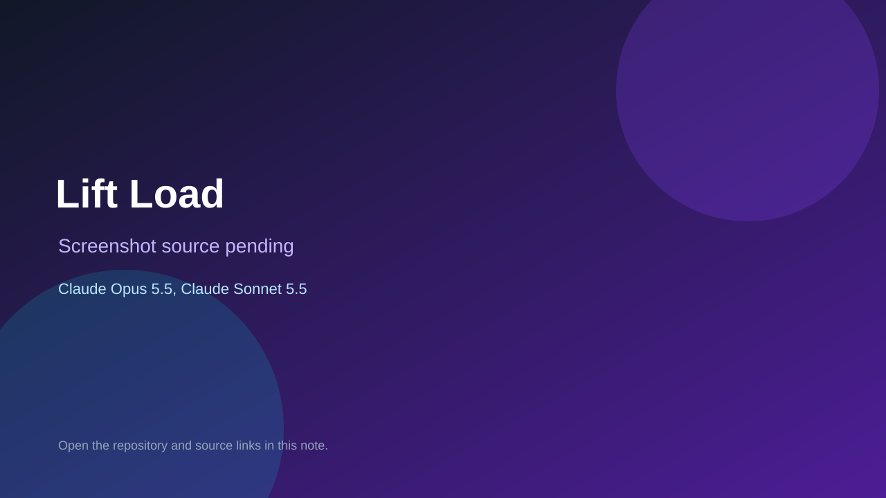

# Lift Load

> Verified game note.

## At a glance

- **Score:** 7.5/10
- **Model:** Claude Opus 5.5, Claude Sonnet 5.5
- **Technology:** Flutter, Dart
- **Estimated FP32 operations/s at 60 FPS:** 100,000,000 (low confidence; static estimate, not measured).
- **Rating basis:** Heuristic from source size, README and commit history (5.8 + 0.6*log10(code KB+1), +0.3 with a reachable demo); no runtime playtest.
- **Verified:** 2026-10-23
- **Repository:** [https://github.com/SubhadipGitHub/Lift-Load](https://github.com/SubhadipGitHub/Lift-Load)
- **Evidence:** [direct model evidence](https://github.com/SubhadipGitHub/Lift-Load/commit/b30a70576b4cf0025bce31ca5c862cda21aafde2)

## Screenshots

No screenshot source is recorded yet. Keep the placeholder until a repository, awesome list, or creator source provides an image.

## Model attribution

Open the evidence link above. Evidence grade: **direct model evidence**.

## Source description

A hybrid-casual Android puzzle. Residents wait in an apartment lobby. You guess who fits in the lift from how they. Commit carries an exact Claude Opus 5.5 / Claude Sonnet 5.5 co-author trailer. Source inspected from README, file tree and commit history only; no playtest.

### Gameplay source

- [https://github.com/SubhadipGitHub/Lift-Load/blob/main/docs/art/layout-frame/index.html](https://github.com/SubhadipGitHub/Lift-Load/blob/main/docs/art/layout-frame/index.html)
- [https://github.com/SubhadipGitHub/Lift-Load/commit/b30a70576b4cf0025bce31ca5c862cda21aafde2](https://github.com/SubhadipGitHub/Lift-Load/commit/b30a70576b4cf0025bce31ca5c862cda21aafde2)

## Verification notes

- **Status:** verified_source
- **Counted units in repository:** 1
- **Units covered by this note:** 1
- **Discovery:** GitHub commit pool: model+game commits 2026-10-21T01:00Z..2026-10-23T01:00Z (20-minute Opus 5.5 and wider other-model UTC partitions) joined to repositories created after 2026-10-20T01:00Z; https://github.com/SubhadipGitHub/Lift-Load

[Back to the awesome list](../../README.md)
