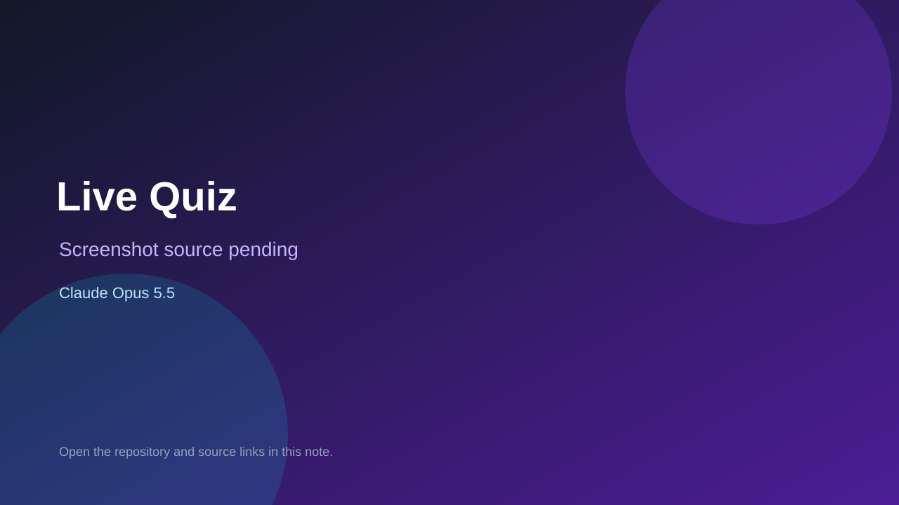

# Live Quiz

> Verified game note.

## At a glance

- **Score:** 7.0/10
- **Model:** Claude Opus 5.5
- **Technology:** TypeScript, Browser
- **Estimated FP32 operations/s at 60 FPS:** 10,000,000 (low confidence; static estimate, not measured).
- **Rating basis:** Heuristic from source size, README and commit history (5.8 + 0.6*log10(code KB+1), +0.3 with a reachable demo); no runtime playtest.
- **Verified:** 2026-10-24
- **Repository:** [https://github.com/l-brendle/live-quiz](https://github.com/l-brendle/live-quiz)
- **Evidence:** [direct model evidence](https://github.com/l-brendle/live-quiz/commit/270627c95667f6cf28ad9f530c40b53f9af8e40f)

## Screenshots

No screenshot source is recorded yet. Keep the placeholder until a repository, awesome list, or creator source provides an image.

## Model attribution

Open the evidence link above. Evidence grade: **direct model evidence**.

## Source description

A small live quiz for a room full of phones. The host writes the questions on the fly, players scan a QR code, choose a nickname and play on their phones. No accounts, no login. Commit carries an exact Claude Opus 5.5 co-author trailer. Source inspected from README, file tree and commit history only; no playtest.

### Gameplay source

- [https://github.com/l-brendle/live-quiz/blob/main/lib/game.ts](https://github.com/l-brendle/live-quiz/blob/main/lib/game.ts)
- [https://github.com/l-brendle/live-quiz/commit/270627c95667f6cf28ad9f530c40b53f9af8e40f](https://github.com/l-brendle/live-quiz/commit/270627c95667f6cf28ad9f530c40b53f9af8e40f)

## Verification notes

- **Status:** verified_source
- **Counted units in repository:** 1
- **Units covered by this note:** 1
- **Discovery:** GitHub commit pool: model+game commits 2026-10-23T01:00Z..2026-10-24T01:00Z (30-minute Opus 5.5 and wider other-model UTC partitions) joined to repositories created after 2026-10-22T01:00Z; https://github.com/l-brendle/live-quiz

[Back to the awesome list](../../README.md)
