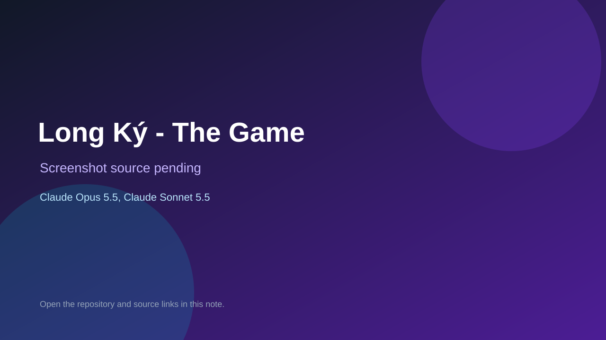

# Long Ký - The Game

> Verified game note.

## At a glance

- **Score:** 7.6/10
- **Model:** Claude Opus 5.5, Claude Sonnet 5.5
- **Technology:** Flutter, Dart
- **Estimated FP32 operations/s at 60 FPS:** 100,000,000 (low confidence; static estimate, not measured).
- **Rating basis:** Heuristic from source size, README and commit history (5.8 + 0.6*log10(code KB+1), +0.3 with a reachable demo); no runtime playtest.
- **Verified:** 2026-10-17
- **Repository:** [https://github.com/binhnt010896/long-ky-card-game](https://github.com/binhnt010896/long-ky-card-game)
- **Evidence:** [direct model evidence](https://github.com/binhnt010896/long-ky-card-game/commit/14b34bea1ba81a05e0a941b706a268482c9d1868)

## Screenshots

No screenshot source is recorded yet. Keep the placeholder until a repository, awesome list, or creator source provides an image.

## Model attribution

Open the evidence link above. Evidence grade: **direct model evidence**.

## Source description

A card game turn-based, based on Long Ky universe. Commit carries an exact Claude Opus 5.5 / Claude Sonnet 5.5 co-author trailer. Source inspected from README, file tree and commit history only; no playtest.

### Gameplay source

- [https://github.com/binhnt010896/long-ky-card-game/blob/main/packages/lk_rules/lib/src/model/game_state.freezed.dart](https://github.com/binhnt010896/long-ky-card-game/blob/main/packages/lk_rules/lib/src/model/game_state.freezed.dart)
- [https://github.com/binhnt010896/long-ky-card-game/commit/14b34bea1ba81a05e0a941b706a268482c9d1868](https://github.com/binhnt010896/long-ky-card-game/commit/14b34bea1ba81a05e0a941b706a268482c9d1868)

## Verification notes

- **Status:** verified_source
- **Counted units in repository:** 1
- **Units covered by this note:** 1
- **Discovery:** GitHub commit pool: model+game commits 2026-10-16..2026-10-17 (1-hour Opus, 3-hour Sonnet, 6-hour other UTC partitions) joined to repositories created after 2026-10-16T00:00Z; https://github.com/binhnt010896/long-ky-card-game

[Back to the awesome list](../../README.md)
