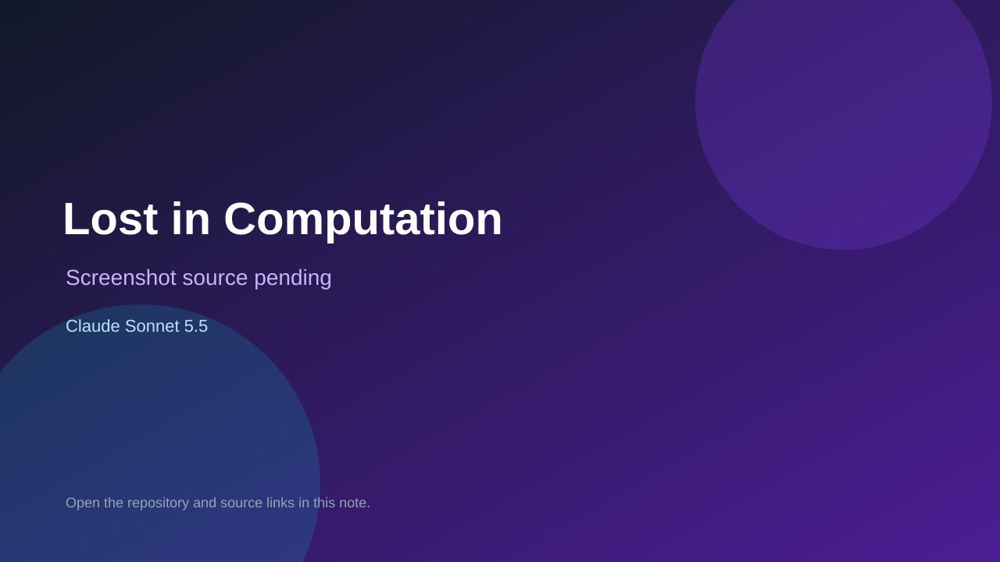

# Lost in Computation

> Verified game note.

## At a glance

- **Score:** 7.3/10
- **Model:** Claude Sonnet 5.5
- **Technology:** TypeScript, Browser
- **Estimated FP32 operations/s at 60 FPS:** 10,000,000 (low confidence; static estimate, not measured).
- **Rating basis:** Heuristic from source size, README and commit history (5.8 + 0.6*log10(code KB+1), +0.3 with a reachable demo); no runtime playtest.
- **Verified:** 2026-10-21
- **Repository:** [https://github.com/Afrah-Sohail/lostincomputation](https://github.com/Afrah-Sohail/lostincomputation)
- **Evidence:** [direct model evidence](https://github.com/Afrah-Sohail/lostincomputation/commit/35f2554394d0ada894a4121a39e2cca09bed1e23)

## Screenshots

No screenshot source is recorded yet. Keep the placeholder until a repository, awesome list, or creator source provides an image.

## Model attribution

Open the evidence link above. Evidence grade: **direct model evidence**.

## Source description

Lost in Computation is a cosmic puzzle game about women who shaped computing. You are an alien trying to fly home. The rocket keeps breaking down, and on each planet a real pioneer teaches one computer science idea you use to fix it. Commit carries an exact Claude Sonnet 5.5 co-author trailer. Source inspected from README, file tree and commit history only; no playtest.

### Gameplay source

- [https://github.com/Afrah-Sohail/lostincomputation/blob/main/components/levels/mechanics/BlueprintMechanic.tsx](https://github.com/Afrah-Sohail/lostincomputation/blob/main/components/levels/mechanics/BlueprintMechanic.tsx)
- [https://github.com/Afrah-Sohail/lostincomputation/commit/35f2554394d0ada894a4121a39e2cca09bed1e23](https://github.com/Afrah-Sohail/lostincomputation/commit/35f2554394d0ada894a4121a39e2cca09bed1e23)

## Verification notes

- **Status:** verified_source
- **Counted units in repository:** 1
- **Units covered by this note:** 1
- **Discovery:** GitHub commit pool: model+game commits 2026-10-17T01:00Z..2026-10-21T01:00Z (1-hour Opus, 3-hour Sonnet, 6-hour other UTC partitions) joined to repositories created after 2026-10-17T00:00Z; https://github.com/Afrah-Sohail/lostincomputation

[Back to the awesome list](../../README.md)
