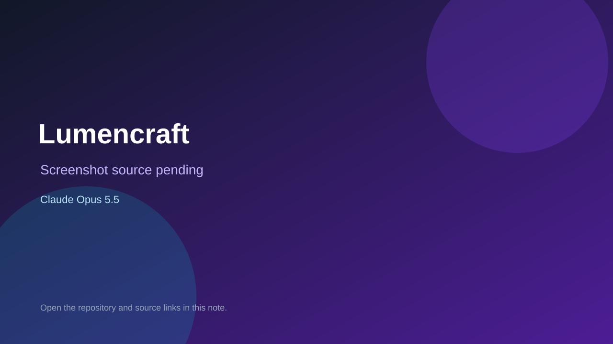

# Lumencraft

> Top-list entry: **today** (#4), **this week** (#4), **this month** (#9).

## At a glance

- **Score:** 8.3/10
- **Model:** Claude Opus 5.5
- **Technology:** JavaScript, WebGL, Browser, Cloudflare
- **Estimated FP32 operations/s at 60 FPS:** 1,500,000,000 (low confidence; static estimate, not measured).
- **Rating basis:** Estimated from README, source tree and commit history; no runtime playtest.
- **Verified:** 2026-10-15
- **Repository:** [https://github.com/TESTYEE-09/opus5.5Minecraft](https://github.com/TESTYEE-09/opus5.5Minecraft)
- **Evidence:** [direct model evidence](https://github.com/TESTYEE-09/opus5.5Minecraft/commit/ebfac969f2afbc5f8c908986c050610ca8f9cde5)
- **Live demo:** [open demo](https://testyee-09.github.io/opus5.5Minecraft/)

## Screenshots

No screenshot source is recorded yet. Keep the placeholder until a repository, awesome list, or creator source provides an image.

## Model attribution

Open the evidence link above. Evidence grade: **direct model evidence**.

## Source description

Browser voxel sandbox with 14 biomes, caves, sky islands, shader-pack lighting and one shared persistent multiplayer world through a Durable Object relay; src/game has player, physics and inventory; commits co-author Claude Opus 5.5. Live demo returned HTTP 200 (availability only, not a playtest). Source inspected only; no playtest.

### Gameplay source

- [https://github.com/TESTYEE-09/opus5.5Minecraft/blob/main/index.html](https://github.com/TESTYEE-09/opus5.5Minecraft/blob/main/index.html)
- [https://github.com/TESTYEE-09/opus5.5Minecraft/commit/ebfac969f2afbc5f8c908986c050610ca8f9cde5](https://github.com/TESTYEE-09/opus5.5Minecraft/commit/ebfac969f2afbc5f8c908986c050610ca8f9cde5)

## Verification notes

- **Status:** verified_source_and_live_demo
- **Counted units in repository:** 1
- **Units covered by this note:** 1
- **Discovery:** GitHub repository search: exact model phrase, created 2026-10-08..2026-10-15 (UTC partitions); https://github.com/TESTYEE-09/opus5.5Minecraft

[Back to the awesome list](../../README.md)
