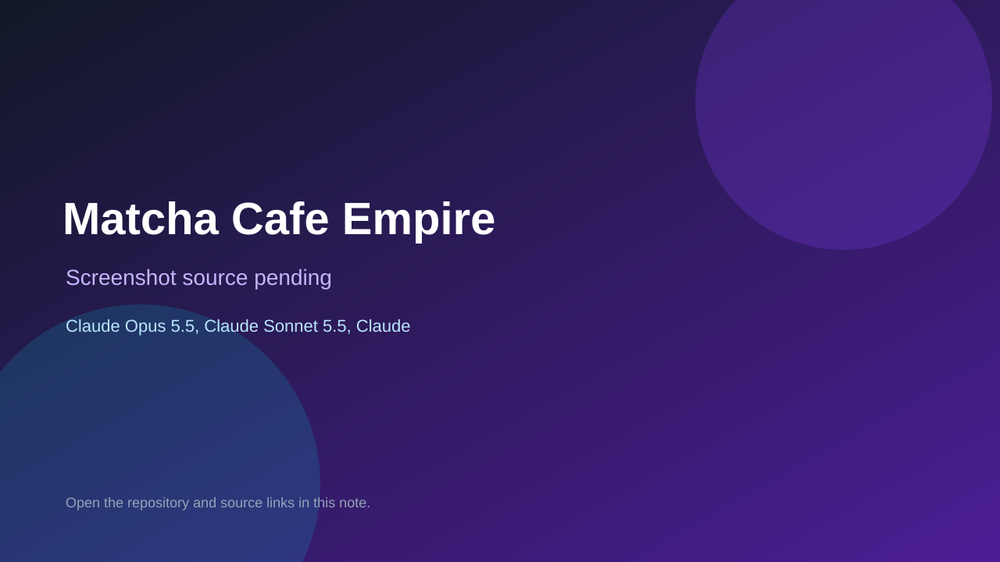

# Matcha Cafe Empire

> Verified game note.

## At a glance

- **Score:** 7.6/10
- **Model:** Claude Opus 5.5, Claude Sonnet 5.5, Claude Fable 5.1
- **Technology:** TypeScript, Browser
- **Estimated FP32 operations/s at 60 FPS:** 100,000,000 (low confidence; static estimate, not measured).
- **Rating basis:** Heuristic from source size, README and commit history (5.8 + 0.6*log10(code KB+1), +0.3 with a reachable demo); no runtime playtest.
- **Verified:** 2026-10-16
- **Repository:** [https://github.com/leesyashin/Tycoon-](https://github.com/leesyashin/Tycoon-)
- **Evidence:** [direct model evidence](https://github.com/leesyashin/Tycoon-/commit/b969096ca89655247a27ac79630bfc89f6ee1eca)

## Screenshots

No screenshot source is recorded yet. Keep the placeholder until a repository, awesome list, or creator source provides an image.

## Model attribution

Open the evidence link above. Evidence grade: **direct model evidence**.

## Source description

Idle/tycoon browser game: grow a Berlin matcha cafe into a chain with staff, equipment, satisfaction and franchise resets; installable PWA. Commit carries an exact Claude Opus 5.5 / Claude Sonnet 5.5 / Claude Fable 5.1 co-author trailer. Source inspected only; no playtest.

### Gameplay source

- [https://github.com/leesyashin/Tycoon-/blob/main/scripts/art/equipment.ts](https://github.com/leesyashin/Tycoon-/blob/main/scripts/art/equipment.ts)
- [https://github.com/leesyashin/Tycoon-/commit/b969096ca89655247a27ac79630bfc89f6ee1eca](https://github.com/leesyashin/Tycoon-/commit/b969096ca89655247a27ac79630bfc89f6ee1eca)

## Verification notes

- **Status:** verified_source
- **Counted units in repository:** 1
- **Units covered by this note:** 1
- **Discovery:** GitHub commit pool: model+game commits 2026-10-15..2026-10-16 (6-hour UTC partitions) joined to repositories created after 2026-10-14T17:00Z; https://github.com/leesyashin/Tycoon-

[Back to the awesome list](../../README.md)
