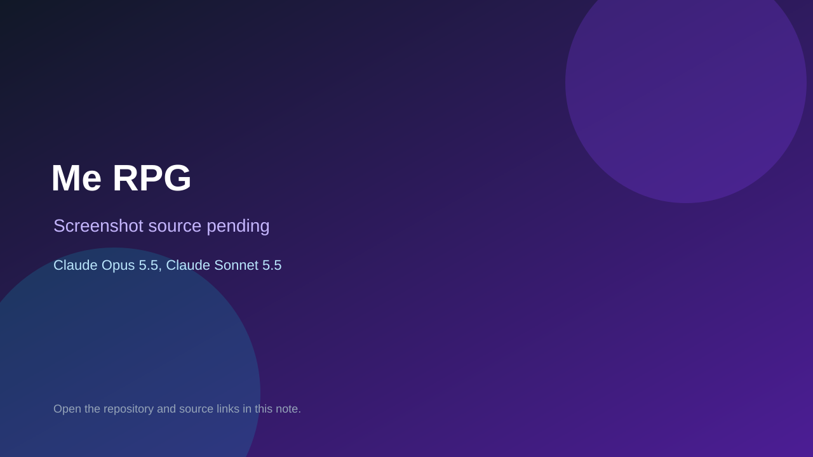

# Me RPG

> Verified game note.

## At a glance

- **Score:** 7.4/10
- **Model:** Claude Opus 5.5, Claude Sonnet 5.5
- **Technology:** TypeScript, PixiJS, Browser
- **Estimated FP32 operations/s at 60 FPS:** 100,000,000 (low confidence; static estimate, not measured).
- **Rating basis:** Estimated from README, source tree and commit history; no runtime playtest.
- **Verified:** 2026-10-15
- **Repository:** [https://github.com/jbogaardt/me_rpg](https://github.com/jbogaardt/me_rpg)
- **Evidence:** [direct model evidence](https://github.com/jbogaardt/me_rpg/commit/b98c4fc201444b1eb5b1467fc3fdf9bff09c3ce4)

## Screenshots

No screenshot source is recorded yet. Keep the placeholder until a repository, awesome list, or creator source provides an image.

## Model attribution

Open the evidence link above. Evidence grade: **direct model evidence**.

## Source description

Top-down PixiJS RPG on GitHub Pages with movement, attacks and NPC talk; Claude Sonnet 5.5 and Opus 5.5 trailers. Source inspected only; no playtest.

### Gameplay source

- [https://github.com/jbogaardt/me_rpg/blob/main/art/lpc_terrain/Terrain.tsx](https://github.com/jbogaardt/me_rpg/blob/main/art/lpc_terrain/Terrain.tsx)
- [https://github.com/jbogaardt/me_rpg/commit/b98c4fc201444b1eb5b1467fc3fdf9bff09c3ce4](https://github.com/jbogaardt/me_rpg/commit/b98c4fc201444b1eb5b1467fc3fdf9bff09c3ce4)

## Verification notes

- **Status:** verified_source
- **Counted units in repository:** 1
- **Units covered by this note:** 1
- **Discovery:** GitHub commit pool: model+game commits 2026-10-08..2026-10-15 joined to repositories created after 2026-10-07T17:00Z; https://github.com/jbogaardt/me_rpg

[Back to the awesome list](../../README.md)
