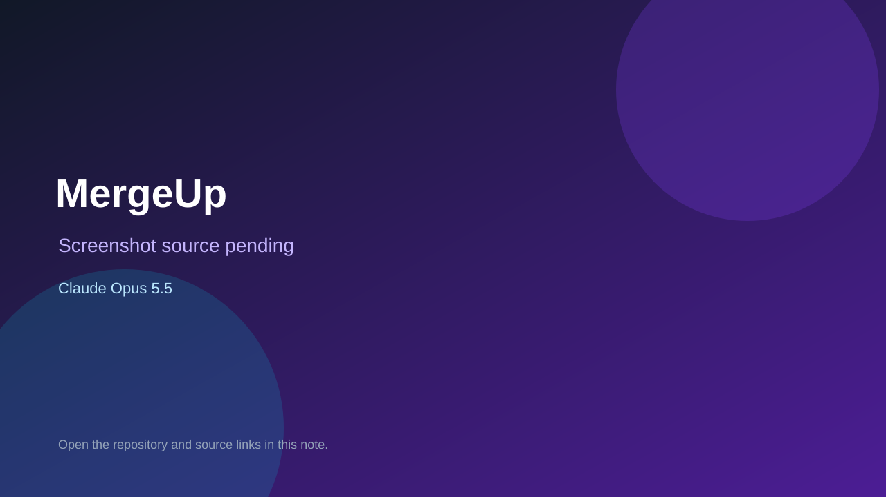

# MergeUp

> Verified game note.

## At a glance

- **Score:** 7.5/10
- **Model:** Claude Opus 5.5
- **Technology:** TypeScript, Browser
- **Estimated FP32 operations/s at 60 FPS:** 10,000,000 (low confidence; static estimate, not measured).
- **Rating basis:** Heuristic from source size, README and commit history (5.8 + 0.6*log10(code KB+1), +0.3 with a reachable demo); no runtime playtest.
- **Verified:** 2026-10-16
- **Repository:** [https://github.com/arKharashi/mergeup](https://github.com/arKharashi/mergeup)
- **Evidence:** [direct model evidence](https://github.com/arKharashi/mergeup/commit/dfd7b1c30a81959e90343a394ad7dbfdf9b65cb8)
- **Live demo:** [open demo](https://arkharashi.github.io/mergeup/)

## Screenshots

No screenshot source is recorded yet. Keep the placeholder until a repository, awesome list, or creator source provides an image.

## Model attribution

Open the evidence link above. Evidence grade: **direct model evidence**.

## Source description

Browser game that teaches git and teamwork: take tasks from a virtual team lead and ship work in a simulated git terminal; English and Arabic. Commit carries an exact Claude Opus 5.5 co-author trailer. Live demo returned HTTP 200 (availability only, not a playtest). Source inspected only; no playtest.

### Gameplay source

- [https://github.com/arKharashi/mergeup/blob/main/e2e/course.mjs](https://github.com/arKharashi/mergeup/blob/main/e2e/course.mjs)
- [https://github.com/arKharashi/mergeup/commit/dfd7b1c30a81959e90343a394ad7dbfdf9b65cb8](https://github.com/arKharashi/mergeup/commit/dfd7b1c30a81959e90343a394ad7dbfdf9b65cb8)

## Verification notes

- **Status:** verified_source
- **Counted units in repository:** 1
- **Units covered by this note:** 1
- **Discovery:** GitHub commit pool: model+game commits 2026-10-15..2026-10-16 (6-hour UTC partitions) joined to repositories created after 2026-10-14T17:00Z; https://github.com/arKharashi/mergeup

[Back to the awesome list](../../README.md)
