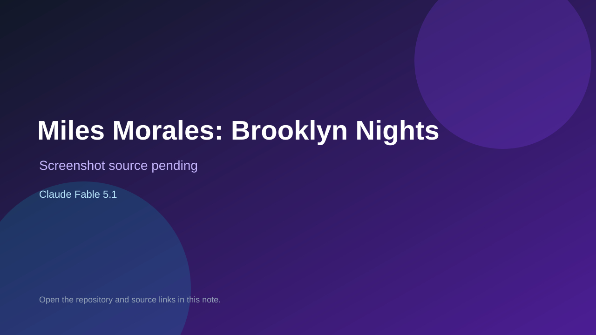

# Miles Morales: Brooklyn Nights

> Verified game note.

## At a glance

- **Score:** 7.6/10
- **Model:** Claude Fable 5.1
- **Technology:** JavaScript, Browser
- **Estimated FP32 operations/s at 60 FPS:** 600,000,000 (low confidence; static estimate, not measured).
- **Rating basis:** Estimated from README, source tree and commit history; no runtime playtest.
- **Verified:** 2026-10-15
- **Repository:** [https://github.com/guichduh33-arch/Video-game](https://github.com/guichduh33-arch/Video-game)
- **Evidence:** [direct model evidence](https://github.com/guichduh33-arch/Video-game/commit/88899989cf9f1e9a7337f789ab131c59d127acc5)

## Screenshots

No screenshot source is recorded yet. Keep the placeholder until a repository, awesome list, or creator source provides an image.

## Model attribution

Open the evidence link above. Evidence grade: **direct model evidence**.

## Source description

Fan-made browser web-swinging game across a night Brooklyn skyline with wall-crawling, crime stops and stealth takedowns; Claude Fable 5.1 trailers on 60 commits. Source inspected only; no playtest.

### Gameplay source

- [https://github.com/guichduh33-arch/Video-game/blob/claude/miles-morales-game/3d.html](https://github.com/guichduh33-arch/Video-game/blob/claude/miles-morales-game/3d.html)
- [https://github.com/guichduh33-arch/Video-game/commit/88899989cf9f1e9a7337f789ab131c59d127acc5](https://github.com/guichduh33-arch/Video-game/commit/88899989cf9f1e9a7337f789ab131c59d127acc5)

## Verification notes

- **Status:** verified_source
- **Counted units in repository:** 1
- **Units covered by this note:** 1
- **Discovery:** GitHub commit pool: model+game commits 2026-10-08..2026-10-15 joined to repositories created after 2026-10-07T17:00Z; https://github.com/guichduh33-arch/Video-game

[Back to the awesome list](../../README.md)
