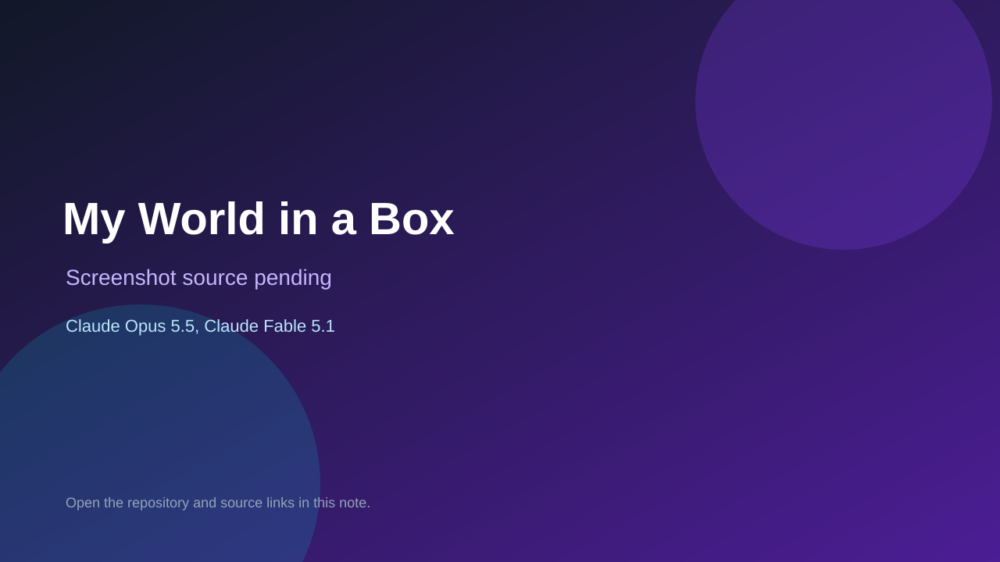

# My World in a Box

> Verified game note.

## At a glance

- **Score:** 7.5/10
- **Model:** Claude Opus 5.5, Claude Fable 5.1
- **Technology:** Godot, GDScript, Android
- **Estimated FP32 operations/s at 60 FPS:** 300,000,000 (low confidence; static estimate, not measured).
- **Rating basis:** Estimated from README, source tree and commit history; no runtime playtest.
- **Verified:** 2026-10-15
- **Repository:** [https://github.com/happihack/MyWorld](https://github.com/happihack/MyWorld)
- **Evidence:** [direct model evidence](https://github.com/happihack/MyWorld/commit/517db20c277408ed231c74e8576ca9e909bd85ae)

## Screenshots

No screenshot source is recorded yet. Keep the placeholder until a repository, awesome list, or creator source provides an image.

## Model attribution

Open the evidence link above. Evidence grade: **direct model evidence**.

## Source description

Android-first Godot 4.7 living-civilization sim inside a box with a game bible and phased plan; commits co-author Claude Opus 5.5 (mostly 1M context) and Claude Fable 5.1. Source inspected only; no playtest.

### Gameplay source

- [https://github.com/happihack/MyWorld/blob/main/scripts/audio/sound_synth.gd](https://github.com/happihack/MyWorld/blob/main/scripts/audio/sound_synth.gd)
- [https://github.com/happihack/MyWorld/commit/517db20c277408ed231c74e8576ca9e909bd85ae](https://github.com/happihack/MyWorld/commit/517db20c277408ed231c74e8576ca9e909bd85ae)

## Verification notes

- **Status:** verified_source
- **Counted units in repository:** 1
- **Units covered by this note:** 1
- **Discovery:** GitHub commit pool: model+game commits 2026-10-08..2026-10-15 joined to repositories created after 2026-10-07T17:00Z; https://github.com/happihack/MyWorld

[Back to the awesome list](../../README.md)
