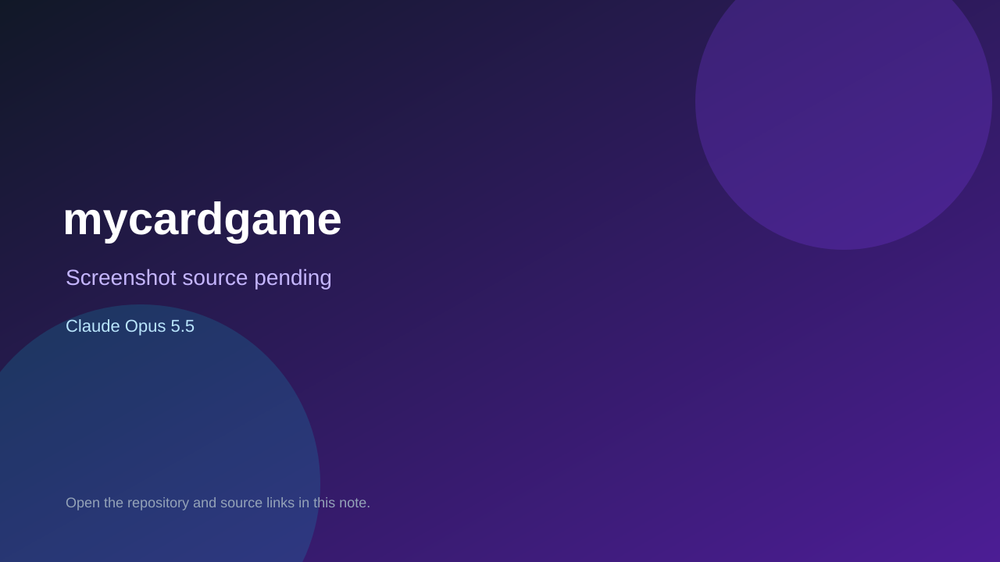

# mycardgame

> Verified game note.

## At a glance

- **Score:** 7.7/10
- **Model:** Claude Opus 5.5
- **Technology:** Godot, GDScript
- **Estimated FP32 operations/s at 60 FPS:** 1,000,000,000 (low confidence; static estimate, not measured).
- **Rating basis:** Heuristic from source size, README and commit history (5.8 + 0.6*log10(code KB+1), +0.3 with a reachable demo); no runtime playtest.
- **Verified:** 2026-10-21
- **Repository:** [https://github.com/justty32/mycardgame](https://github.com/justty32/mycardgame)
- **Evidence:** [direct model evidence](https://github.com/justty32/mycardgame/commit/ea502183c74f6e3ba1eb77517a111910c85fd385)

## Screenshots

No screenshot source is recorded yet. Keep the placeholder until a repository, awesome list, or creator source provides an image.

## Model attribution

Open the evidence link above. Evidence grade: **direct model evidence**.

## Source description

以 Slay-The-Robot 為框架的個人卡牌遊戲專案，引擎基準為 Godot 4.7.2。此版本建立可持續開發的程式基準、回歸測試與 agent 工作流。根目錄是題材中立的框架；各款遊戲的設計、決策與內容包在 games/，每款一棵題材樹。. Commit carries an exact Claude Opus 5.5 co-author trailer. Source inspected from README, file tree and commit history only; no playtest.

### Gameplay source

- [https://github.com/justty32/mycardgame/blob/main/game/autoload/GlobalTestDataGenerator.gd](https://github.com/justty32/mycardgame/blob/main/game/autoload/GlobalTestDataGenerator.gd)
- [https://github.com/justty32/mycardgame/commit/ea502183c74f6e3ba1eb77517a111910c85fd385](https://github.com/justty32/mycardgame/commit/ea502183c74f6e3ba1eb77517a111910c85fd385)

## Verification notes

- **Status:** verified_source
- **Counted units in repository:** 1
- **Units covered by this note:** 1
- **Discovery:** GitHub commit pool: model+game commits 2026-10-17T01:00Z..2026-10-21T01:00Z (1-hour Opus, 3-hour Sonnet, 6-hour other UTC partitions) joined to repositories created after 2026-10-17T00:00Z; https://github.com/justty32/mycardgame

[Back to the awesome list](../../README.md)
