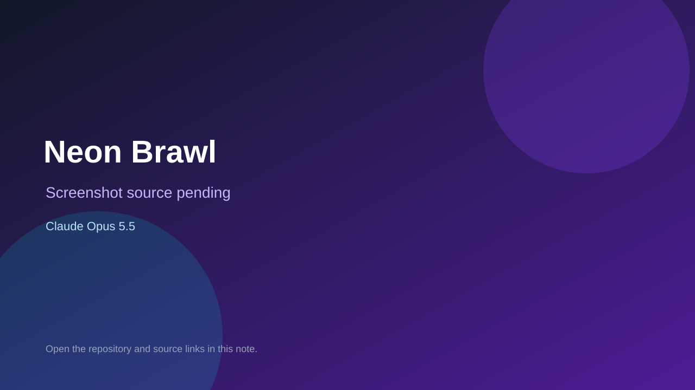

# Neon Brawl

> Verified game note.

## At a glance

- **Score:** 7.3/10
- **Model:** Claude Opus 5.5
- **Technology:** JavaScript, Three.js, Browser
- **Estimated FP32 operations/s at 60 FPS:** 1,000,000,000 (low confidence; static estimate, not measured).
- **Rating basis:** Heuristic from source size, README and commit history (5.8 + 0.6*log10(code KB+1), +0.3 with a reachable demo); no runtime playtest.
- **Verified:** 2026-10-16
- **Repository:** [https://github.com/maxvbuda/fight](https://github.com/maxvbuda/fight)
- **Evidence:** [direct model evidence](https://github.com/maxvbuda/fight/commit/e9f84520ffe15bdb4f5c8840b30701f64ea2681e)
- **Live demo:** [open demo](https://maxvbuda.github.io/fight/)

## Screenshots

No screenshot source is recorded yet. Keep the placeholder until a repository, awesome list, or creator source provides an image.

## Model attribution

Open the evidence link above. Evidence grade: **direct model evidence**.

## Source description

3D browser fighting game in three.js with CPU, local two-player and PeerJS online modes plus a spectator page. Commit carries an exact Claude Opus 5.5 co-author trailer. Live demo returned HTTP 200 (availability only, not a playtest). Source inspected only; no playtest.

### Gameplay source

- [https://github.com/maxvbuda/fight/blob/main/game.js](https://github.com/maxvbuda/fight/blob/main/game.js)
- [https://github.com/maxvbuda/fight/commit/e9f84520ffe15bdb4f5c8840b30701f64ea2681e](https://github.com/maxvbuda/fight/commit/e9f84520ffe15bdb4f5c8840b30701f64ea2681e)

## Verification notes

- **Status:** verified_source
- **Counted units in repository:** 1
- **Units covered by this note:** 1
- **Discovery:** GitHub commit pool: model+game commits 2026-10-15..2026-10-16 (6-hour UTC partitions) joined to repositories created after 2026-10-14T17:00Z; https://github.com/maxvbuda/fight

[Back to the awesome list](../../README.md)
