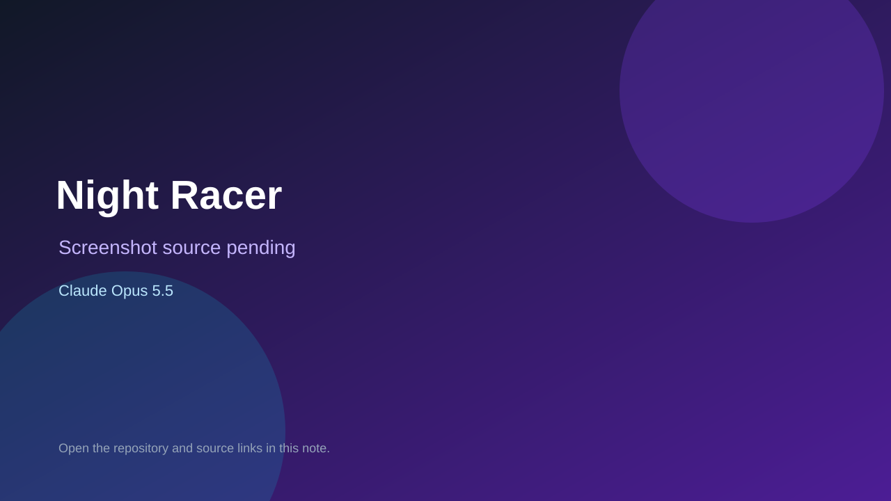

# Night Racer

> Top-list entry: **today** (#7).

## At a glance

- **Score:** 7.8/10
- **Model:** Claude Opus 5.5
- **Technology:** JavaScript, Three.js, Browser
- **Estimated FP32 operations/s at 60 FPS:** 1,000,000,000 (low confidence; static estimate, not measured).
- **Rating basis:** Heuristic from source size, README and commit history (5.8 + 0.6*log10(code KB+1), +0.3 with a reachable demo); no runtime playtest.
- **Verified:** 2026-10-16
- **Repository:** [https://github.com/zhuqipaopao-maker/night-racer-public](https://github.com/zhuqipaopao-maker/night-racer-public)
- **Evidence:** [direct model evidence](https://github.com/zhuqipaopao-maker/night-racer-public/commit/76b27eab1c43115a99e39796ea24a0ff669ca5f8)
- **Live demo:** [open demo](https://night-racer.pages.dev)

## Screenshots

No screenshot source is recorded yet. Keep the placeholder until a repository, awesome list, or creator source provides an image.

## Model attribution

Open the evidence link above. Evidence grade: **direct model evidence**.

## Source description

3D browser racing game with ten-plus procedurally built maps, AI races, ghost time trials, online rooms, leaderboards and a garage. Commit carries an exact Claude Opus 5.5 co-author trailer. Live demo returned HTTP 200 (availability only, not a playtest). Source inspected only; no playtest.

### Gameplay source

- [https://github.com/zhuqipaopao-maker/night-racer-public/blob/main/src/main.js](https://github.com/zhuqipaopao-maker/night-racer-public/blob/main/src/main.js)
- [https://github.com/zhuqipaopao-maker/night-racer-public/commit/76b27eab1c43115a99e39796ea24a0ff669ca5f8](https://github.com/zhuqipaopao-maker/night-racer-public/commit/76b27eab1c43115a99e39796ea24a0ff669ca5f8)

## Verification notes

- **Status:** verified_source
- **Counted units in repository:** 1
- **Units covered by this note:** 1
- **Discovery:** GitHub commit pool: model+game commits 2026-10-15..2026-10-16 (6-hour UTC partitions) joined to repositories created after 2026-10-14T17:00Z; https://github.com/zhuqipaopao-maker/night-racer-public

[Back to the awesome list](../../README.md)
