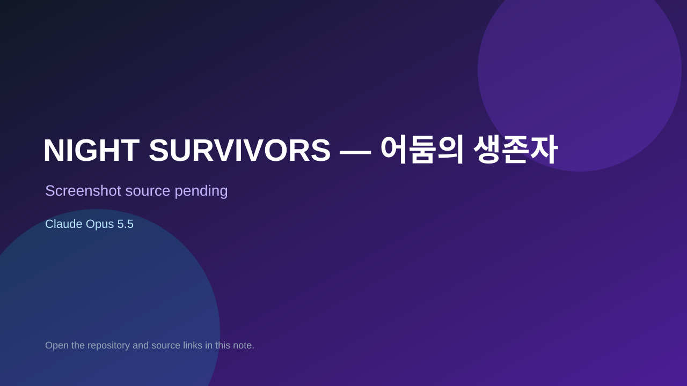

# NIGHT SURVIVORS — 어둠의 생존자

> Verified game note.

## At a glance

- **Score:** 7.0/10
- **Model:** Claude Opus 5.5
- **Technology:** JavaScript, Browser
- **Estimated FP32 operations/s at 60 FPS:** 100,000,000 (low confidence; static estimate, not measured).
- **Rating basis:** Heuristic from source size, README and commit history (5.8 + 0.6*log10(code KB+1), +0.3 with a reachable demo); no runtime playtest.
- **Verified:** 2026-10-17
- **Repository:** [https://github.com/kkob728/claudeproject](https://github.com/kkob728/claudeproject)
- **Evidence:** [direct model evidence](https://github.com/kkob728/claudeproject/commit/edb2c4466919b5157888c6d2f4cada38de554312)

## Screenshots

No screenshot source is recorded yet. Keep the placeholder until a repository, awesome list, or creator source provides an image.

## Model attribution

Open the evidence link above. Evidence grade: **direct model evidence**.

## Source description

뱀파이어 서바이버즈 스타일의 웹 게임입니다. 순수 HTML + CSS + JavaScript(Canvas 2D)로 만들었고,. Commit carries an exact Claude Opus 5.5 co-author trailer. Source inspected from README, file tree and commit history only; no playtest.

### Gameplay source

- [https://github.com/kkob728/claudeproject/blob/claude/adoring-franklin-8v96vm/game.js](https://github.com/kkob728/claudeproject/blob/claude/adoring-franklin-8v96vm/game.js)
- [https://github.com/kkob728/claudeproject/commit/edb2c4466919b5157888c6d2f4cada38de554312](https://github.com/kkob728/claudeproject/commit/edb2c4466919b5157888c6d2f4cada38de554312)

## Verification notes

- **Status:** verified_source
- **Counted units in repository:** 1
- **Units covered by this note:** 1
- **Discovery:** GitHub commit pool: model+game commits 2026-10-16..2026-10-17 (1-hour Opus, 3-hour Sonnet, 6-hour other UTC partitions) joined to repositories created after 2026-10-16T00:00Z; https://github.com/kkob728/claudeproject

[Back to the awesome list](../../README.md)
