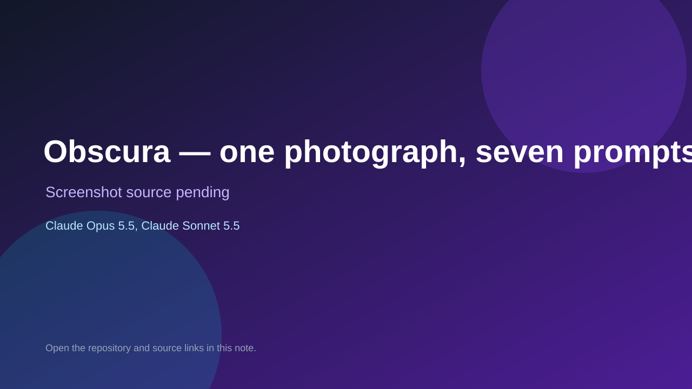

# Obscura — one photograph, seven prompts, one guess

> Verified game note.

## At a glance

- **Score:** 8.0/10
- **Model:** Claude Opus 5.5, Claude Sonnet 5.5
- **Technology:** TypeScript, Browser
- **Estimated FP32 operations/s at 60 FPS:** 10,000,000 (low confidence; static estimate, not measured).
- **Rating basis:** Heuristic from source size, README and commit history (5.8 + 0.6*log10(code KB+1), +0.3 with a reachable demo); no runtime playtest.
- **Verified:** 2026-10-21
- **Repository:** [https://github.com/stoketog/Obscura](https://github.com/stoketog/Obscura)
- **Evidence:** [direct model evidence](https://github.com/stoketog/Obscura/commit/a982fcba8a340227183f986ddd95b681c959edca)
- **Live demo:** [open demo](https://obscura-stoke2.vercel.app)

## Screenshots

No screenshot source is recorded yet. Keep the placeholder until a repository, awesome list, or creator source provides an image.

## Model attribution

Open the evidence link above. Evidence grade: **direct model evidence**.

## Source description

A daily game about the obscure. Every day a real photograph hangs in a dark room (the camera obscura). Seven shared prompts ("Name a cheese"), 30 seconds each: type any answer that fits, and the rarer it is, the more points it earns and the more light gets… Commit carries an exact Claude Opus 5.5 / Claude Sonnet 5.5 co-author trailer. Live demo returned HTTP 200 (availability only, not a playtest). Source inspected from README, file tree and commit history only; no playtest.

### Gameplay source

- [https://github.com/stoketog/Obscura/blob/main/src/data/prompts/extra/generated.ts](https://github.com/stoketog/Obscura/blob/main/src/data/prompts/extra/generated.ts)
- [https://github.com/stoketog/Obscura/commit/a982fcba8a340227183f986ddd95b681c959edca](https://github.com/stoketog/Obscura/commit/a982fcba8a340227183f986ddd95b681c959edca)

## Verification notes

- **Status:** verified_source
- **Counted units in repository:** 1
- **Units covered by this note:** 1
- **Discovery:** GitHub commit pool: model+game commits 2026-10-17T01:00Z..2026-10-21T01:00Z (1-hour Opus, 3-hour Sonnet, 6-hour other UTC partitions) joined to repositories created after 2026-10-17T00:00Z; https://github.com/stoketog/Obscura

[Back to the awesome list](../../README.md)
