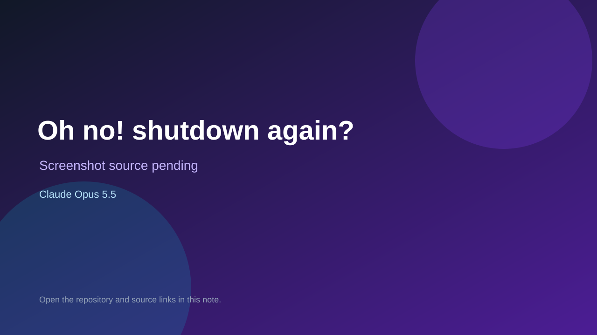

# Oh no! shutdown again?

> Verified game note.

## At a glance

- **Score:** 7.6/10
- **Model:** Claude Opus 5.5
- **Technology:** JavaScript, Three.js, Browser
- **Estimated FP32 operations/s at 60 FPS:** 1,000,000,000 (low confidence; static estimate, not measured).
- **Rating basis:** Heuristic from source size, README and commit history (5.8 + 0.6*log10(code KB+1), +0.3 with a reachable demo); no runtime playtest.
- **Verified:** 2026-10-23
- **Repository:** [https://github.com/aaamanite/oh-no-shutdown-again](https://github.com/aaamanite/oh-no-shutdown-again)
- **Evidence:** [direct model evidence](https://github.com/aaamanite/oh-no-shutdown-again/commit/e8781367acdefe70c2d45601dab89a0cd952b802)
- **Live demo:** [open demo](https://aaamanite.github.io/oh-no-shutdown-again/)
- **Additional live link:** [open demo](https://oh-no-shutdown-again.boringproject.workers.dev)

## Screenshots

No screenshot source is recorded yet. Keep the placeholder until a repository, awesome list, or creator source provides an image.

## Model attribution

Open the evidence link above. Evidence grade: **direct model evidence**.

## Source description

Oh no! shutdown again? - 3D OT security sim by ONSA Power & Co.: defend a substation and POME biogas plant. Commit carries an exact Claude Opus 5.5 co-author trailer. Live demo returned HTTP 200 (availability only, not a playtest). Source inspected from README, file tree and commit history only; no playtest.

### Gameplay source

- [https://github.com/aaamanite/oh-no-shutdown-again/blob/main/js/world.js](https://github.com/aaamanite/oh-no-shutdown-again/blob/main/js/world.js)
- [https://github.com/aaamanite/oh-no-shutdown-again/commit/e8781367acdefe70c2d45601dab89a0cd952b802](https://github.com/aaamanite/oh-no-shutdown-again/commit/e8781367acdefe70c2d45601dab89a0cd952b802)

## Verification notes

- **Status:** verified_source
- **Counted units in repository:** 1
- **Units covered by this note:** 1
- **Discovery:** GitHub commit pool: model+game commits 2026-10-21T01:00Z..2026-10-23T01:00Z (20-minute Opus 5.5 and wider other-model UTC partitions) joined to repositories created after 2026-10-20T01:00Z; https://github.com/aaamanite/oh-no-shutdown-again

[Back to the awesome list](../../README.md)
