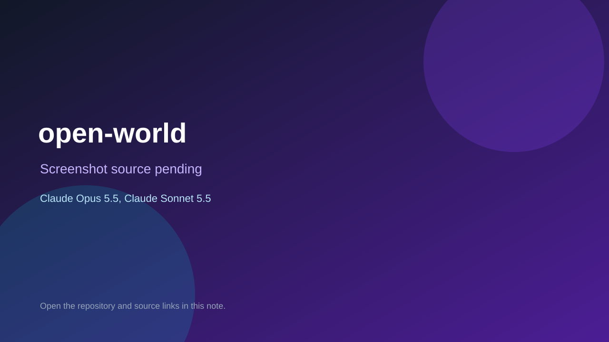

# open-world

> Top-list entry: **today** (#8).

## At a glance

- **Score:** 7.8/10
- **Model:** Claude Opus 5.5, Claude Sonnet 5.5
- **Technology:** TypeScript, React, Three.js, Browser
- **Estimated FP32 operations/s at 60 FPS:** 1,000,000,000 (low confidence; static estimate, not measured).
- **Rating basis:** Heuristic from source size, README and commit history (5.8 + 0.6*log10(code KB+1), +0.3 with a reachable demo); no runtime playtest.
- **Verified:** 2026-10-16
- **Repository:** [https://github.com/mamamaki12/open-world](https://github.com/mamamaki12/open-world)
- **Evidence:** [direct model evidence](https://github.com/mamamaki12/open-world/commit/8d0af0002f6369c5e43175c61f5c9aa137b47b26)
- **Live demo:** [open demo](https://mamamaki12.github.io/open-world/)

## Screenshots

No screenshot source is recorded yet. Keep the placeholder until a repository, awesome list, or creator source provides an image.

## Model attribution

Open the evidence link above. Evidence grade: **direct model evidence**.

## Source description

Browser house-building and economy game: earn, build, sell and rebuild, with casino and horse-race minigames and rule tests. Commit carries an exact Claude Opus 5.5 / Claude Sonnet 5.5 co-author trailer. Live demo returned HTTP 200 (availability only, not a playtest). Source inspected only; no playtest.

### Gameplay source

- [https://github.com/mamamaki12/open-world/blob/main/src/world/Player.tsx](https://github.com/mamamaki12/open-world/blob/main/src/world/Player.tsx)
- [https://github.com/mamamaki12/open-world/commit/8d0af0002f6369c5e43175c61f5c9aa137b47b26](https://github.com/mamamaki12/open-world/commit/8d0af0002f6369c5e43175c61f5c9aa137b47b26)

## Verification notes

- **Status:** verified_source
- **Counted units in repository:** 1
- **Units covered by this note:** 1
- **Discovery:** GitHub commit pool: model+game commits 2026-10-15..2026-10-16 (6-hour UTC partitions) joined to repositories created after 2026-10-14T17:00Z; https://github.com/mamamaki12/open-world

[Back to the awesome list](../../README.md)
