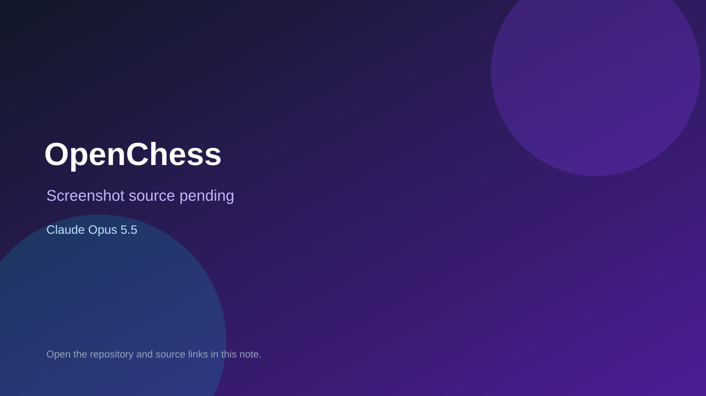

# OpenChess

> Verified game note.

## At a glance

- **Score:** 7.0/10
- **Model:** Claude Opus 5.5
- **Technology:** JavaScript, Browser
- **Estimated FP32 operations/s at 60 FPS:** 10,000,000 (low confidence; static estimate, not measured).
- **Rating basis:** Heuristic from source size, README and commit history (5.8 + 0.6*log10(code KB+1), +0.3 with a reachable demo); no runtime playtest.
- **Verified:** 2026-10-23
- **Repository:** [https://github.com/GSM10-3/OpenChess](https://github.com/GSM10-3/OpenChess)
- **Evidence:** [direct model evidence](https://github.com/GSM10-3/OpenChess/commit/7726fd780a9aeee06e23c210a2f0db7caca2473a)

## Screenshots

No screenshot source is recorded yet. Keep the placeholder until a repository, awesome list, or creator source provides an image.

## Model attribution

Open the evidence link above. Evidence grade: **direct model evidence**.

## Source description

OpenFront 식 영토 전쟁(땅 · 병력 · 공격 비율 · 배 · 핵 · 봇)에 체스 규칙을 더한 브라우저 게임입니다. Commit carries an exact Claude Opus 5.5 co-author trailer. Source inspected from README, file tree and commit history only; no playtest.

### Gameplay source

- [https://github.com/GSM10-3/OpenChess/blob/main/src/game/Game.js](https://github.com/GSM10-3/OpenChess/blob/main/src/game/Game.js)
- [https://github.com/GSM10-3/OpenChess/commit/7726fd780a9aeee06e23c210a2f0db7caca2473a](https://github.com/GSM10-3/OpenChess/commit/7726fd780a9aeee06e23c210a2f0db7caca2473a)

## Verification notes

- **Status:** verified_source
- **Counted units in repository:** 1
- **Units covered by this note:** 1
- **Discovery:** GitHub commit pool: model+game commits 2026-10-21T01:00Z..2026-10-23T01:00Z (20-minute Opus 5.5 and wider other-model UTC partitions) joined to repositories created after 2026-10-20T01:00Z; https://github.com/GSM10-3/OpenChess

[Back to the awesome list](../../README.md)
