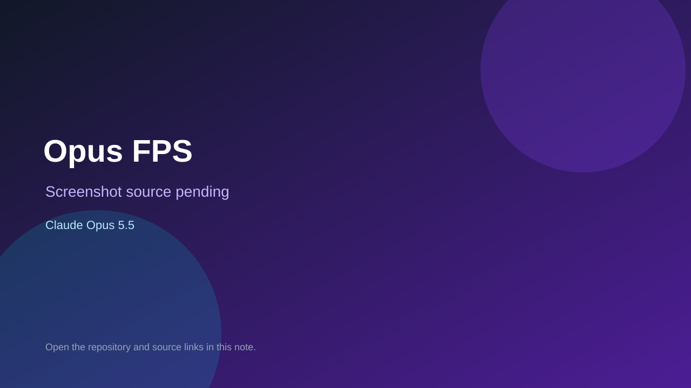

# Opus FPS

> Top-list entry: **today** (#10), **this week** (#12).

## At a glance

- **Score:** 8.0/10
- **Model:** Claude Opus 5.5
- **Technology:** Godot, GDScript
- **Estimated FP32 operations/s at 60 FPS:** 600,000,000 (low confidence; static estimate, not measured).
- **Rating basis:** Estimated from README, source tree and commit history; no runtime playtest.
- **Verified:** 2026-10-15
- **Repository:** [https://github.com/frankhale/opus-fps](https://github.com/frankhale/opus-fps)
- **Evidence:** [creator-reported model evidence](https://github.com/frankhale/opus-fps/blob/main/README.md)

## Screenshots

No screenshot source is recorded yet. Keep the placeholder until a repository, awesome list, or creator source provides an image.

## Model attribution

Open the evidence link above. Evidence grade: **creator-reported model evidence**.

## Source description

PS1-look Godot 4 FPS: hunt floating eyes and rock golems across a valley, village, outpost and ruins, with explosive barrels, gems and portals; every model and sound is script-generated. Description and README call it an experiment in creating a Godot FPS with Opus 5.5; no trailer. Source inspected only; no playtest.

### Gameplay source

- [https://github.com/frankhale/opus-fps/blob/main/README.md](https://github.com/frankhale/opus-fps/blob/main/README.md)

## Verification notes

- **Status:** verified_source
- **Counted units in repository:** 1
- **Units covered by this note:** 1
- **Discovery:** GitHub repository search: exact model phrase, created 2026-10-08..2026-10-15 (UTC partitions); https://github.com/frankhale/opus-fps

[Back to the awesome list](../../README.md)
