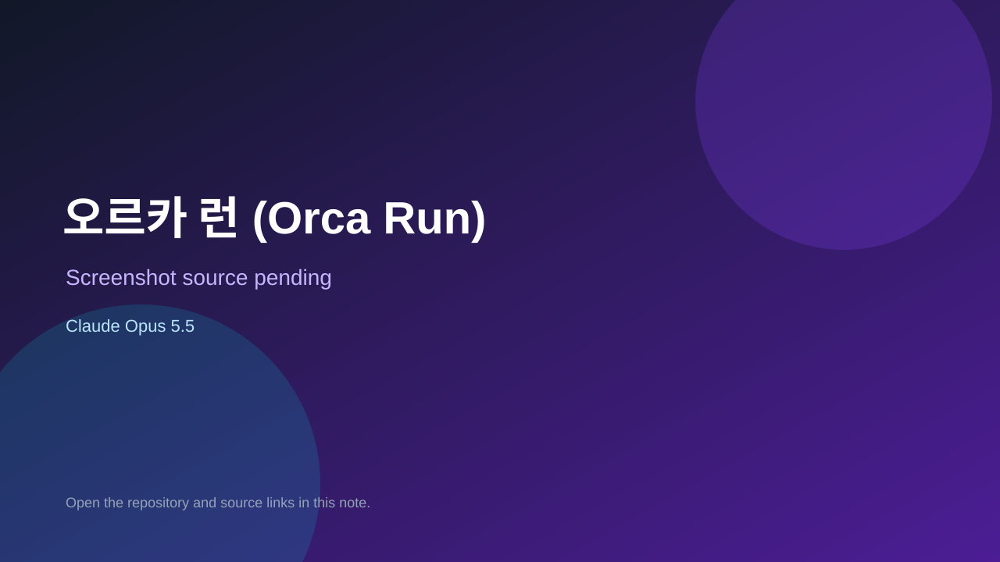

# 오르카 런 (Orca Run)

> Top-list entry: **today** (#4), **this week** (#6), **this month** (#6).

## At a glance

- **Score:** 8.6/10
- **Model:** Claude Opus 5.5
- **Technology:** Unity, C#
- **Estimated FP32 operations/s at 60 FPS:** 1,000,000,000 (low confidence; static estimate, not measured).
- **Rating basis:** Heuristic from source size, README and commit history (5.8 + 0.6*log10(code KB+1), +0.3 with a reachable demo); no runtime playtest.
- **Verified:** 2026-10-21
- **Repository:** [https://github.com/isinjia/LAO_Run](https://github.com/isinjia/LAO_Run)
- **Evidence:** [direct model evidence](https://github.com/isinjia/LAO_Run/commit/3468c690fa3f00c26cb311133b3d18f86c3b2b22)

## Screenshots

No screenshot source is recorded yet. Keep the placeholder until a repository, awesome list, or creator source provides an image.

## Model attribution

Open the evidence link above. Evidence grade: **direct model evidence**.

## Source description

라스트오리진 SD 대원으로 달리는 쿠키런 스타일 러너. SD 리그 런타임(js/sd.js)과 SD 데이터(js/sd/)는. Commit carries an exact Claude Opus 5.5 co-author trailer. Source inspected from README, file tree and commit history only; no playtest.

### Gameplay source

- [https://github.com/isinjia/LAO_Run/blob/main/js/fx/DoomEater_skill1_Eat_skill1_F.js](https://github.com/isinjia/LAO_Run/blob/main/js/fx/DoomEater_skill1_Eat_skill1_F.js)
- [https://github.com/isinjia/LAO_Run/commit/3468c690fa3f00c26cb311133b3d18f86c3b2b22](https://github.com/isinjia/LAO_Run/commit/3468c690fa3f00c26cb311133b3d18f86c3b2b22)

## Verification notes

- **Status:** verified_source
- **Counted units in repository:** 1
- **Units covered by this note:** 1
- **Discovery:** GitHub commit pool: model+game commits 2026-10-17T01:00Z..2026-10-21T01:00Z (1-hour Opus, 3-hour Sonnet, 6-hour other UTC partitions) joined to repositories created after 2026-10-17T00:00Z; https://github.com/isinjia/LAO_Run

[Back to the awesome list](../../README.md)
