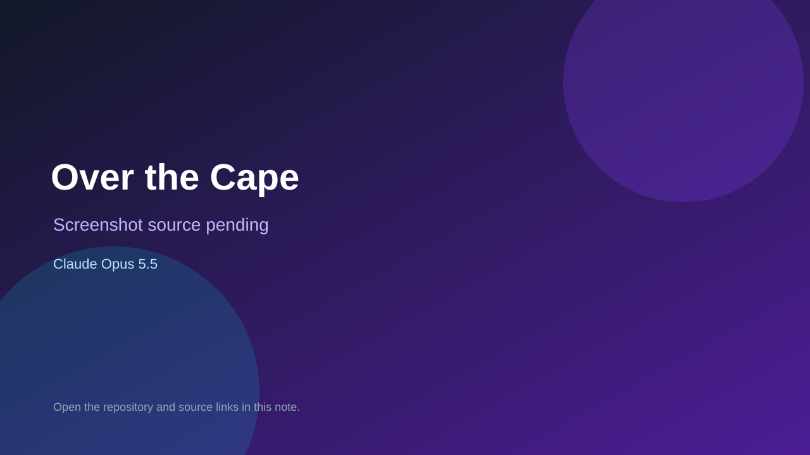

# Over the Cape

> Verified game note.

## At a glance

- **Score:** 8.0/10
- **Model:** Claude Opus 5.5
- **Technology:** TypeScript, Three.js, Browser
- **Estimated FP32 operations/s at 60 FPS:** 1,000,000,000 (low confidence; static estimate, not measured).
- **Rating basis:** Heuristic from source size, README and commit history (5.8 + 0.6*log10(code KB+1), +0.3 with a reachable demo); no runtime playtest.
- **Verified:** 2026-10-23
- **Repository:** [https://github.com/reidstephen11/over-the-cape](https://github.com/reidstephen11/over-the-cape)
- **Evidence:** [direct model evidence](https://github.com/reidstephen11/over-the-cape/commit/3797e6d84bb4664d6680ac1f37230b5f8686000c)
- **Live demo:** [open demo](https://reidstephen11.github.io/over-the-cape/)

## Screenshots

No screenshot source is recorded yet. Keep the placeholder until a repository, awesome list, or creator source provides an image.

## Model attribution

Open the evidence link above. Evidence grade: **direct model evidence**.

## Source description

A single-player 4WD adventure up Cape York, told in episodes, that runs in the browser. Each episode is a stage of the trip north, from the Daintree to the tip of Australia, with its own map, a core mission, the weather and time of day the story sets, and a… Commit carries an exact Claude Opus 5.5 co-author trailer. Live demo returned HTTP 200 (availability only, not a playtest). Source inspected from README, file tree and commit history only; no playtest.

### Gameplay source

- [https://github.com/reidstephen11/over-the-cape/blob/main/src/core/game.ts](https://github.com/reidstephen11/over-the-cape/blob/main/src/core/game.ts)
- [https://github.com/reidstephen11/over-the-cape/commit/3797e6d84bb4664d6680ac1f37230b5f8686000c](https://github.com/reidstephen11/over-the-cape/commit/3797e6d84bb4664d6680ac1f37230b5f8686000c)

## Verification notes

- **Status:** verified_source
- **Counted units in repository:** 1
- **Units covered by this note:** 1
- **Discovery:** GitHub commit pool: model+game commits 2026-10-21T01:00Z..2026-10-23T01:00Z (20-minute Opus 5.5 and wider other-model UTC partitions) joined to repositories created after 2026-10-20T01:00Z; https://github.com/reidstephen11/over-the-cape

[Back to the awesome list](../../README.md)
