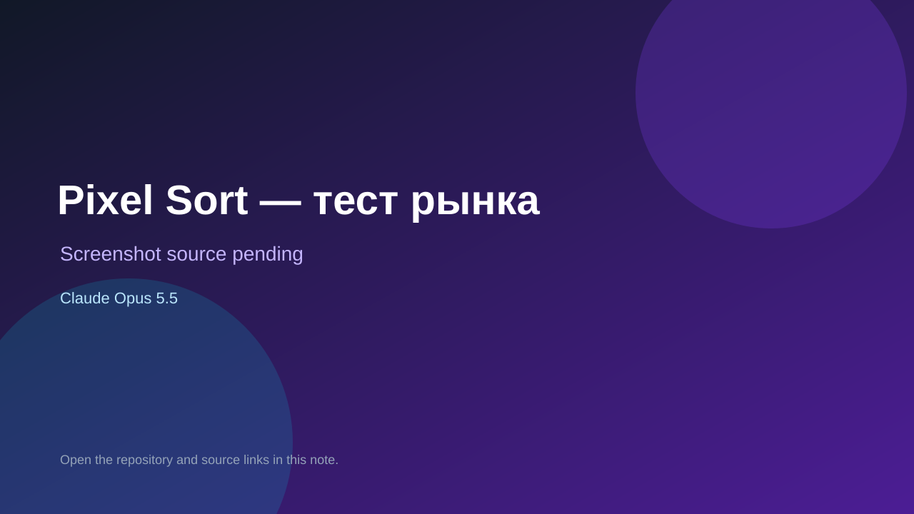

# Pixel Sort — тест рынка

> Verified game note.

## At a glance

- **Score:** 7.6/10
- **Model:** Claude Opus 5.5
- **Technology:** JavaScript, Browser
- **Estimated FP32 operations/s at 60 FPS:** 10,000,000 (low confidence; static estimate, not measured).
- **Rating basis:** Heuristic from source size, README and commit history (5.8 + 0.6*log10(code KB+1), +0.3 with a reachable demo); no runtime playtest.
- **Verified:** 2026-10-17
- **Repository:** [https://github.com/Caypoh23/pixel-sort](https://github.com/Caypoh23/pixel-sort)
- **Evidence:** [direct model evidence](https://github.com/Caypoh23/pixel-sort/commit/ab165746fb7284ea1716f6d90aa79e62a97b11eb)
- **Live demo:** [open demo](https://caypoh23.github.io/pixel-sort/)
- **Additional live link:** [open demo](https://caypoh23.github.io/pixel-sort/?utm_source=meta&utm_medium=paid&utm_campaign=test1&utm_content=AD1)

## Screenshots

No screenshot source is recorded yet. Keep the placeholder until a repository, awesome list, or creator source provides an image.

## Model attribution

Open the evidence link above. Evidence grade: **direct model evidence**.

## Source description

Pixel Sort: browser demo, gameplay clips and market test automation. Commit carries an exact Claude Opus 5.5 co-author trailer. Live demo returned HTTP 200 (availability only, not a playtest). Source inspected from README, file tree and commit history only; no playtest.

### Gameplay source

- [https://github.com/Caypoh23/pixel-sort/blob/main/docs/index.html](https://github.com/Caypoh23/pixel-sort/blob/main/docs/index.html)
- [https://github.com/Caypoh23/pixel-sort/commit/ab165746fb7284ea1716f6d90aa79e62a97b11eb](https://github.com/Caypoh23/pixel-sort/commit/ab165746fb7284ea1716f6d90aa79e62a97b11eb)

## Verification notes

- **Status:** verified_source
- **Counted units in repository:** 1
- **Units covered by this note:** 1
- **Discovery:** GitHub commit pool: model+game commits 2026-10-16..2026-10-17 (1-hour Opus, 3-hour Sonnet, 6-hour other UTC partitions) joined to repositories created after 2026-10-16T00:00Z; https://github.com/Caypoh23/pixel-sort

[Back to the awesome list](../../README.md)
