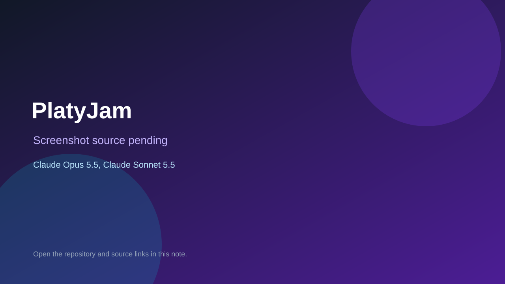

# PlatyJam

> Verified game note.

## At a glance

- **Score:** 7.7/10
- **Model:** Claude Opus 5.5, Claude Sonnet 5.5
- **Technology:** TypeScript, Three.js, Browser
- **Estimated FP32 operations/s at 60 FPS:** 1,000,000,000 (low confidence; static estimate, not measured).
- **Rating basis:** Heuristic from source size, README and commit history (5.8 + 0.6*log10(code KB+1), +0.3 with a reachable demo); no runtime playtest.
- **Verified:** 2026-10-21
- **Repository:** [https://github.com/JeffreyVdb/PlatyJam](https://github.com/JeffreyVdb/PlatyJam)
- **Evidence:** [direct model evidence](https://github.com/JeffreyVdb/PlatyJam/commit/d90258856b8b14ad903fe65c67ea18287d2b386c)
- **Live demo:** [open demo](https://jeffreyvdb.github.io/PlatyJam/)
- **Additional live link:** [open demo](https://jeffreyvdb.github.io/PlatyJam/?debug)

## Screenshots

No screenshot source is recorded yet. Keep the placeholder until a repository, awesome list, or creator source provides an image.

## Model attribution

Open the evidence link above. Evidence grade: **direct model evidence**.

## Source description

A browser-based musical rhythm game with a planned Rust backend and Three.js visuals. Commit carries an exact Claude Opus 5.5 / Claude Sonnet 5.5 co-author trailer. Live demo returned HTTP 200 (availability only, not a playtest). Source inspected from README, file tree and commit history only; no playtest.

### Gameplay source

- [https://github.com/JeffreyVdb/PlatyJam/blob/main/web/src/scene/game-stage.ts](https://github.com/JeffreyVdb/PlatyJam/blob/main/web/src/scene/game-stage.ts)
- [https://github.com/JeffreyVdb/PlatyJam/commit/d90258856b8b14ad903fe65c67ea18287d2b386c](https://github.com/JeffreyVdb/PlatyJam/commit/d90258856b8b14ad903fe65c67ea18287d2b386c)

## Verification notes

- **Status:** verified_source
- **Counted units in repository:** 1
- **Units covered by this note:** 1
- **Discovery:** GitHub commit pool: model+game commits 2026-10-17T01:00Z..2026-10-21T01:00Z (1-hour Opus, 3-hour Sonnet, 6-hour other UTC partitions) joined to repositories created after 2026-10-17T00:00Z; https://github.com/JeffreyVdb/PlatyJam

[Back to the awesome list](../../README.md)
