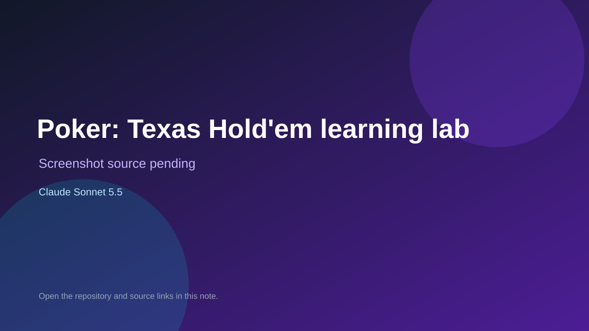

# Poker: Texas Hold'em learning lab

> Top-list entry: **this week** (#15).

## At a glance

- **Score:** 7.9/10
- **Model:** Claude Sonnet 5.5
- **Technology:** HTML, JavaScript, Canvas, Browser
- **Estimated FP32 operations/s at 60 FPS:** 100,000,000 (low confidence; static estimate, not measured).
- **Rating basis:** Estimated from README, source tree and commit history; no runtime playtest.
- **Verified:** 2026-10-15
- **Repository:** [https://github.com/flakeer/poker-trainer](https://github.com/flakeer/poker-trainer)
- **Evidence:** [direct model evidence](https://github.com/flakeer/poker-trainer/commit/5fc1bb82ca1a7d4b730cf709e3d8ddae8e44dc11)
- **Live demo:** [open demo](https://flakeer.github.io/poker-trainer/)

## Screenshots

No screenshot source is recorded yet. Keep the placeholder until a repository, awesome list, or creator source provides an image.

## Model attribution

Open the evidence link above. Evidence grade: **direct model evidence**.

## Source description

Offline Texas Hold'em trainer with adaptive AI opponents, equity and decision review, a 12-level roadmap and fairness tests; README says vibe-coded with Claude Sonnet 5.5 and commits carry exact Sonnet 5.5 trailers. Live demo returned HTTP 200 (availability only, not a playtest). Source inspected only; no playtest.

### Gameplay source

- [https://github.com/flakeer/poker-trainer/blob/main/build.js](https://github.com/flakeer/poker-trainer/blob/main/build.js)
- [https://github.com/flakeer/poker-trainer/commit/5fc1bb82ca1a7d4b730cf709e3d8ddae8e44dc11](https://github.com/flakeer/poker-trainer/commit/5fc1bb82ca1a7d4b730cf709e3d8ddae8e44dc11)

## Verification notes

- **Status:** verified_source_and_live_demo
- **Counted units in repository:** 1
- **Units covered by this note:** 1
- **Discovery:** GitHub repository search: exact model phrase, created 2026-10-08..2026-10-15 (UTC partitions); https://github.com/flakeer/poker-trainer

[Back to the awesome list](../../README.md)
