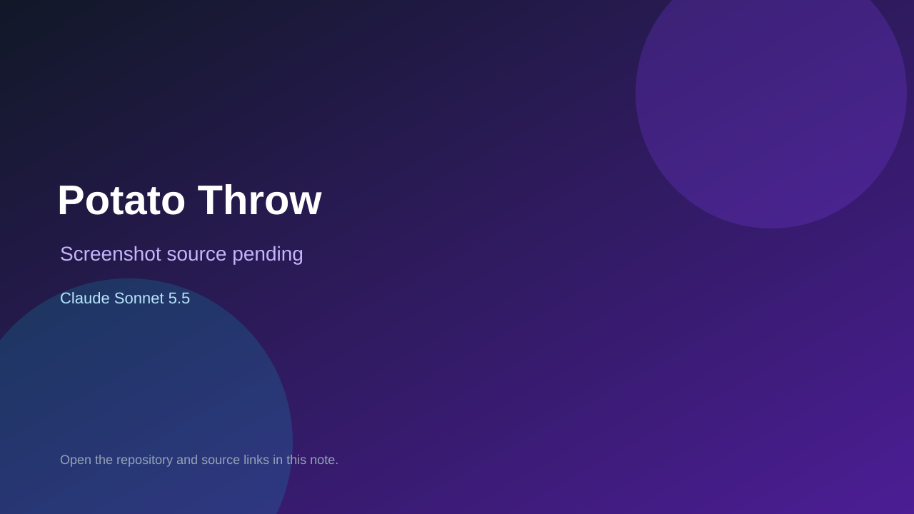

# Potato Throw

> Verified game note.

## At a glance

- **Score:** 6.0/10
- **Model:** Claude Sonnet 5.5
- **Technology:** Shell
- **Estimated FP32 operations/s at 60 FPS:** 1,000,000 (low confidence; static estimate, not measured).
- **Rating basis:** Heuristic from source size, README and commit history (5.8 + 0.6*log10(code KB+1), +0.3 with a reachable demo); no runtime playtest.
- **Verified:** 2026-10-17
- **Repository:** [https://github.com/MProffitt-RedGate/potato-throw](https://github.com/MProffitt-RedGate/potato-throw)
- **Evidence:** [direct model evidence](https://github.com/MProffitt-RedGate/potato-throw/commit/2752f6625f77f35ec5cc66a6d7149c23c9ab9568)

## Screenshots

No screenshot source is recorded yet. Keep the placeholder until a repository, awesome list, or creator source provides an image.

## Model attribution

Open the evidence link above. Evidence grade: **direct model evidence**.

## Source description

Small CL game, made with Claude. Commit carries an exact Claude Sonnet 5.5 co-author trailer. Source inspected from README, file tree and commit history only; no playtest.

### Gameplay source

- [https://github.com/MProffitt-RedGate/potato-throw/blob/main/.claude/hooks/protect-sensitive-files.py](https://github.com/MProffitt-RedGate/potato-throw/blob/main/.claude/hooks/protect-sensitive-files.py)
- [https://github.com/MProffitt-RedGate/potato-throw/commit/2752f6625f77f35ec5cc66a6d7149c23c9ab9568](https://github.com/MProffitt-RedGate/potato-throw/commit/2752f6625f77f35ec5cc66a6d7149c23c9ab9568)

## Verification notes

- **Status:** verified_source
- **Counted units in repository:** 1
- **Units covered by this note:** 1
- **Discovery:** GitHub repository search: exact model phrase, created 2026-10-16T00:00Z..2026-10-17T01:30Z; https://github.com/MProffitt-RedGate/potato-throw

[Back to the awesome list](../../README.md)
