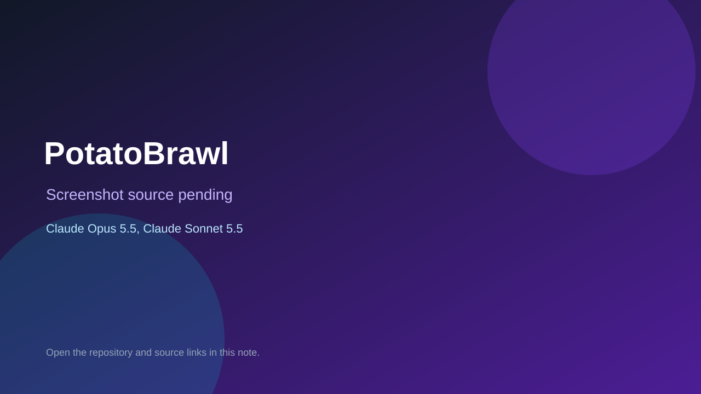

# PotatoBrawl

> Verified game note.

## At a glance

- **Score:** 7.6/10
- **Model:** Claude Opus 5.5, Claude Sonnet 5.5
- **Technology:** JavaScript, Node, Browser
- **Estimated FP32 operations/s at 60 FPS:** 100,000,000 (low confidence; static estimate, not measured).
- **Rating basis:** Estimated from README, source tree and commit history; no runtime playtest.
- **Verified:** 2026-10-15
- **Repository:** [https://github.com/guspliffy/potatobrawl](https://github.com/guspliffy/potatobrawl)
- **Evidence:** [direct model evidence](https://github.com/guspliffy/potatobrawl/commit/648448cb2f45fc7eb91f8de0548e5031fed03e68)

## Screenshots

No screenshot source is recorded yet. Keep the placeholder until a repository, awesome list, or creator source provides an image.

## Model attribution

Open the evidence link above. Evidence grade: **direct model evidence**.

## Source description

1v1 potato platform fighter in the browser with online matches relayed by a small Node server; Claude Opus 5.5 (1M context) and Sonnet 5.5 trailers. Source inspected only; no playtest.

### Gameplay source

- [https://github.com/guspliffy/potatobrawl/blob/main/accounts.js](https://github.com/guspliffy/potatobrawl/blob/main/accounts.js)
- [https://github.com/guspliffy/potatobrawl/commit/648448cb2f45fc7eb91f8de0548e5031fed03e68](https://github.com/guspliffy/potatobrawl/commit/648448cb2f45fc7eb91f8de0548e5031fed03e68)

## Verification notes

- **Status:** verified_source
- **Counted units in repository:** 1
- **Units covered by this note:** 1
- **Discovery:** GitHub commit pool: model+game commits 2026-10-08..2026-10-15 joined to repositories created after 2026-10-07T17:00Z; https://github.com/guspliffy/potatobrawl

[Back to the awesome list](../../README.md)
