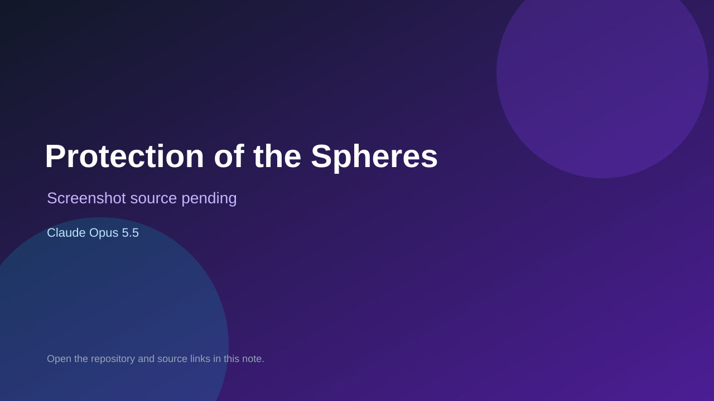

# Protection of the Spheres

> Verified game note.

## At a glance

- **Score:** 7.9/10
- **Model:** Claude Opus 5.5
- **Technology:** Rust, Browser
- **Estimated FP32 operations/s at 60 FPS:** 1,000,000,000 (low confidence; static estimate, not measured).
- **Rating basis:** Heuristic from source size, README and commit history (5.8 + 0.6*log10(code KB+1), +0.3 with a reachable demo); no runtime playtest.
- **Verified:** 2026-10-17
- **Repository:** [https://github.com/sgilson7/pots](https://github.com/sgilson7/pots)
- **Evidence:** [direct model evidence](https://github.com/sgilson7/pots/commit/f2dcdd14074ee3f0803e0f98deaf959f3d5a005a)
- **Live demo:** [open demo](https://sgilson7.github.io/pots/)

## Screenshots

No screenshot source is recorded yet. Keep the placeholder until a repository, awesome list, or creator source provides an image.

## Model attribution

Open the evidence link above. Evidence grade: **direct model evidence**.

## Source description

Protection of the Spheres: a browser game that plays like DotA Allstars, with heroes of its own. Arcade missions against computer players and 5v5 online with rollback netcode. Commit carries an exact Claude Opus 5.5 co-author trailer. Live demo returned HTTP 200 (availability only, not a playtest). Source inspected from README, file tree and commit history only; no playtest.

### Gameplay source

- [https://github.com/sgilson7/pots/blob/main/journal/pots-journal.html](https://github.com/sgilson7/pots/blob/main/journal/pots-journal.html)
- [https://github.com/sgilson7/pots/commit/f2dcdd14074ee3f0803e0f98deaf959f3d5a005a](https://github.com/sgilson7/pots/commit/f2dcdd14074ee3f0803e0f98deaf959f3d5a005a)

## Verification notes

- **Status:** verified_source
- **Counted units in repository:** 1
- **Units covered by this note:** 1
- **Discovery:** GitHub commit pool: model+game commits 2026-10-16..2026-10-17 (1-hour Opus, 3-hour Sonnet, 6-hour other UTC partitions) joined to repositories created after 2026-10-16T00:00Z; https://github.com/sgilson7/pots

[Back to the awesome list](../../README.md)
