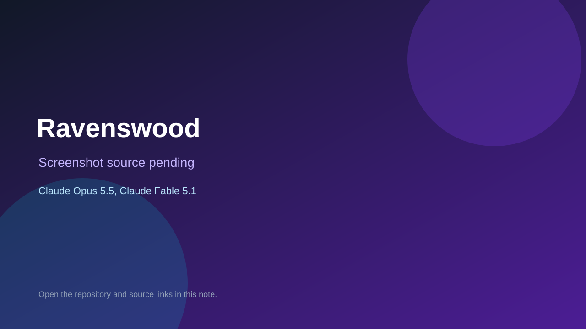

# Ravenswood

> Top-list entry: **today** (#1), **this week** (#7), **this month** (#8).

## At a glance

- **Score:** 8.5/10
- **Model:** Claude Opus 5.5, Claude Fable 5.1
- **Technology:** TypeScript, Browser
- **Estimated FP32 operations/s at 60 FPS:** 1,000,000,000 (low confidence; static estimate, not measured).
- **Rating basis:** Heuristic from source size, README and commit history (5.8 + 0.6*log10(code KB+1), +0.3 with a reachable demo); no runtime playtest.
- **Verified:** 2026-10-23
- **Repository:** [https://github.com/adcam02/Ravenswood](https://github.com/adcam02/Ravenswood)
- **Evidence:** [direct model evidence](https://github.com/adcam02/Ravenswood/commit/77e3489a1d3ed96c595e028beb06a161f591a742)

## Screenshots

No screenshot source is recorded yet. Keep the placeholder until a repository, awesome list, or creator source provides an image.

## Model attribution

Open the evidence link above. Evidence grade: **direct model evidence**.

## Source description

Blood on the Clocktower as a cosy 3D village. Everyone is an animal walking around town, talking with. Commit carries an exact Claude Opus 5.5 / Claude Fable 5.1 co-author trailer. Source inspected from README, file tree and commit history only; no playtest.

### Gameplay source

- [https://github.com/adcam02/Ravenswood/blob/main/docs/assets/index-BPhJyVus.js](https://github.com/adcam02/Ravenswood/blob/main/docs/assets/index-BPhJyVus.js)
- [https://github.com/adcam02/Ravenswood/commit/77e3489a1d3ed96c595e028beb06a161f591a742](https://github.com/adcam02/Ravenswood/commit/77e3489a1d3ed96c595e028beb06a161f591a742)

## Verification notes

- **Status:** verified_source
- **Counted units in repository:** 1
- **Units covered by this note:** 1
- **Discovery:** GitHub commit pool: model+game commits 2026-10-21T01:00Z..2026-10-23T01:00Z (20-minute Opus 5.5 and wider other-model UTC partitions) joined to repositories created after 2026-10-20T01:00Z; https://github.com/adcam02/Ravenswood

[Back to the awesome list](../../README.md)
