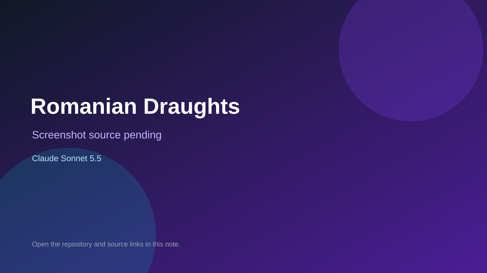

# Romanian Draughts

> Verified game note.

## At a glance

- **Score:** 7.0/10
- **Model:** Claude Sonnet 5.5
- **Technology:** JavaScript, Browser
- **Estimated FP32 operations/s at 60 FPS:** 10,000,000 (low confidence; static estimate, not measured).
- **Rating basis:** Heuristic from source size, README and commit history (5.8 + 0.6*log10(code KB+1), +0.3 with a reachable demo); no runtime playtest.
- **Verified:** 2026-10-23
- **Repository:** [https://github.com/magicobject/RomanianDraughts](https://github.com/magicobject/RomanianDraughts)
- **Evidence:** [direct model evidence](https://github.com/magicobject/RomanianDraughts/commit/af92a1cf1527e895d19ae84bb94eeff4275c6511)

## Screenshots

No screenshot source is recorded yet. Keep the placeholder until a repository, awesome list, or creator source provides an image.

## Model attribution

Open the evidence link above. Evidence grade: **direct model evidence**.

## Source description

A browser game of Romanian Draughts: an all-kings draughts variant, 8 kings a side, where pieces may jump their own men as well as the opponent's and captures are optional. Play two players on one screen, or against the computer (easy, medium, hard). Commit carries an exact Claude Sonnet 5.5 co-author trailer. Source inspected from README, file tree and commit history only; no playtest.

### Gameplay source

- [https://github.com/magicobject/RomanianDraughts/blob/main/public/js/game.js](https://github.com/magicobject/RomanianDraughts/blob/main/public/js/game.js)
- [https://github.com/magicobject/RomanianDraughts/commit/af92a1cf1527e895d19ae84bb94eeff4275c6511](https://github.com/magicobject/RomanianDraughts/commit/af92a1cf1527e895d19ae84bb94eeff4275c6511)

## Verification notes

- **Status:** verified_source
- **Counted units in repository:** 1
- **Units covered by this note:** 1
- **Discovery:** GitHub commit pool: model+game commits 2026-10-21T01:00Z..2026-10-23T01:00Z (20-minute Opus 5.5 and wider other-model UTC partitions) joined to repositories created after 2026-10-20T01:00Z; https://github.com/magicobject/RomanianDraughts

[Back to the awesome list](../../README.md)
