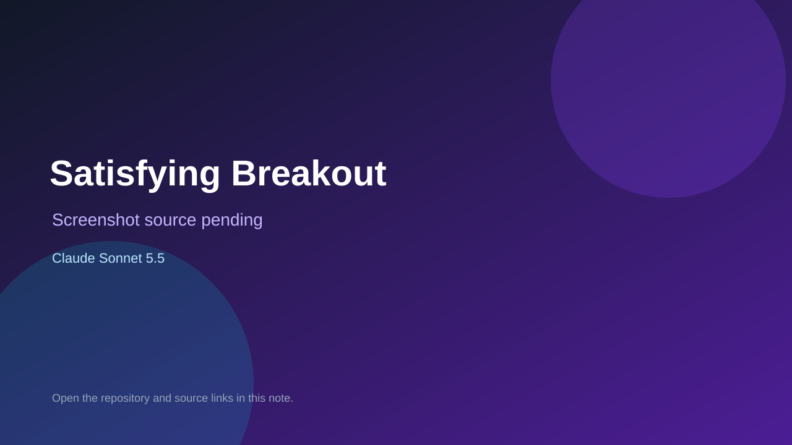

# Satisfying Breakout

> Verified game note.

## At a glance

- **Score:** 6.7/10
- **Model:** Claude Sonnet 5.5
- **Technology:** HTML, JavaScript, Canvas, Browser
- **Estimated FP32 operations/s at 60 FPS:** 100,000,000 (low confidence; static estimate, not measured).
- **Rating basis:** Heuristic from source size, README and commit history (5.8 + 0.6*log10(code KB+1), +0.3 with a reachable demo); no runtime playtest.
- **Verified:** 2026-10-16
- **Repository:** [https://github.com/hfujikawa77/satisfying-breakout](https://github.com/hfujikawa77/satisfying-breakout)
- **Evidence:** [direct model evidence](https://github.com/hfujikawa77/satisfying-breakout/commit/dcaef4fc7ecaeb94e32c8cf187a9ec7694992097)

## Screenshots

No screenshot source is recorded yet. Keep the placeholder until a repository, awesome list, or creator source provides an image.

## Model attribution

Open the evidence link above. Evidence grade: **direct model evidence**.

## Source description

Pixel-block breakout in one HTML file with orbs for +3, x2, bombs and paddle size changes. Commit carries an exact Claude Sonnet 5.5 co-author trailer. Source inspected only; no playtest.

### Gameplay source

- [https://github.com/hfujikawa77/satisfying-breakout/blob/main/index.html](https://github.com/hfujikawa77/satisfying-breakout/blob/main/index.html)
- [https://github.com/hfujikawa77/satisfying-breakout/commit/dcaef4fc7ecaeb94e32c8cf187a9ec7694992097](https://github.com/hfujikawa77/satisfying-breakout/commit/dcaef4fc7ecaeb94e32c8cf187a9ec7694992097)

## Verification notes

- **Status:** verified_source
- **Counted units in repository:** 1
- **Units covered by this note:** 1
- **Discovery:** GitHub commit pool: model+game commits 2026-10-15..2026-10-16 (6-hour UTC partitions) joined to repositories created after 2026-10-14T17:00Z; https://github.com/hfujikawa77/satisfying-breakout

[Back to the awesome list](../../README.md)
